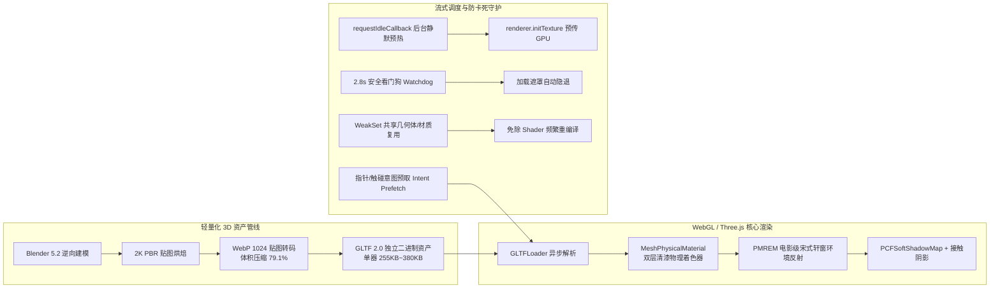

# 天青泥火 (Sky-Cyan & Kiln Fire) — 华夏古瓷三维数字化沉浸研学空间 (v7.0)

> **器以载道 · 格物致知 · 中国古代传统文化与宋韵古陶瓷 3D 数字化交互研鉴空间**  
> *An Interactive WebGL 3D Heritage & Digital Connoisseurship Space for Ancient Chinese Ceramics*

[](https://sherlockyzz.github.io/Memories-of-Chinese-Porcelain-Web/)
[](https://hub.xerj.org/contributors/SherlockYzz)
[](https://api.xiaomimimo.com)
[](https://threejs.org/)
[](https://github.com/SherlockYzz/Memories-of-Chinese-Porcelain-Web)
[](https://github.com/SherlockYzz/Memories-of-Chinese-Porcelain-Web)
[](https://github.com/SherlockYzz/Memories-of-Chinese-Porcelain-Web)
[](https://github.com/SherlockYzz/Memories-of-Chinese-Porcelain-Web)
[](https://creativecommons.org/licenses/by-nc-sa/4.0/)

---

## 🌐 线上体验与工程下载

* 🌟 **线上沉浸体验 (GitHub Pages)**：  
  👉 **[https://sherlockyzz.github.io/Memories-of-Chinese-Porcelain-Web/](https://sherlockyzz.github.io/Memories-of-Chinese-Porcelain-Web/)**  
  *(全平台自适应：PC 端、平板与移动端即开即鉴，支持单器 360° 微距、双器同屏对比、100x 景深显微镜、全息剖面透视与昼夜意境一键切换)*

* 📦 **本地脱网工程发布包 (零依赖，脱网即开即用)**：  
  * 完整包含 8 尊 Blender 5.2 高精 PBR 传世国宝模型、实测激光扫描孪生体、12 件小米 MiMo 馆长原声音频、非遗实录视频与全站离线资产：  
    👉 `天青泥火_V7.0_Release.zip`  
  * **启动方式**：解压后直接双击 `index.html` 即可畅爽体验，无跨域报错，零外部服务器依赖。

---

## 🏆 权威收录与开源技术标杆 (Official Recognition)

* 🌐 **入选全球 AI 原生代码语料库 (XERJ Corpus Hub)**：  
  本项目纯原生前端三维研鉴架构、100x 景深微距着色器算法与双器同台对比矩阵获评为全球高质量开源技术范例，已由开源 AI 搜索引擎 [XERJ](https://github.com/xerj-org/xerj) 官方正式索引收录：  
  👉 **[SherlockYzz Contributor Profile @ XERJ Corpus Hub](https://hub.xerj.org/contributors/SherlockYzz)**  
  *(作为全球开发者与 Coding Agent 解决同类复杂 WebGL 渲染、物理级景深与微观图形学难题的标准参考实现 Worked Reference)*

---

## 🏛️ 项目定位与核心使命

古陶瓷是中华文明“泥与火的炼金术”，承载着两宋极简美学、大唐盛世气象与明清繁复工艺的高峰。然而，在传统实体博物馆和常规二维数字展馆中，观众与研究者始终面临着难以逾越的**「五大物理与认知痛点」**：

1. **视距深锁与角度局限**：国宝珍品深锁于展柜厚重的防弹玻璃之后，观众只能远距离观察单一面貌，无法俯瞰口沿流线、近抚瓶肩曲率，亦无法感知器物的真实体量尺度；
2. **底足盲区与考据割裂**：文博界自古有“鉴瓷先看底”之铁律。底足露胎的紫金土质、芝麻细小支钉、垫饼刮釉痕迹以及历代御窑年款，是定窑口、断年代的关键证据，但在展柜中器物永远底足朝下，观众根本无缘窥见；
3. **胎骨力学与工艺不可视**：“薄胎厚釉”、“口薄底厚”是宋瓷烧造的力学奇迹，但普通观众肉眼只能看到表层釉色，根本无法理解内部胎骨的截面厚度变化与成型掏膛力学；
4. **微观矿物晶相缺失**：宋代汝窑的“寥若晨星”、官窑的“聚沫攒珠”、哥窑的“金丝铁线”以及宣德苏料的“锡光沉降”，均属于微米级的釉下物理现象，缺乏专业显微光学仪器根本无法感知其微观肌理；
5. **单向静态展示缺乏参与感**：静态图文无法传递“水火相济”的非遗生命力，观众无法亲身体验揉泥拉坯的余弦形变、青花勾线分水的笔墨韵味以及 1300℃ 烈火出窑开片的清脆震撼。

### 本项目的破局之道
《天青泥火》基于 **WebGL (Three.js r128)**、**Blender 5.2 物理级逆向拓扑**、**双层清漆物理渲染管线**以及**纯前端计算机视觉算法**，构建起一套融“文物鉴赏、微观科研、声学物理、非遗造物”于一体的古陶瓷全息三维沉浸空间，让沉睡在博物馆里的千年名瓷在数字世界中真正“活起来、可触摸、能研鉴”。

---

## 🏺 核心功能与文博学术研鉴体系

```mermaid
flowchart TD
    Root["天青泥火 · 华夏古瓷三维数字化研学空间"]
    
    Root --> M1["🏛️ 3D 展馆多维研学体系"]
    Root --> M2["⚖️ 左右双器同台并列比对"]
    Root --> M3["🔬 100x 光学景深物镜显微镜"]
    Root --> M4["🌈 AI 多光谱微应力分析工作站"]
    Root --> M5["🏺 3D 陶埏拉坯与青花造物工坊"]
    Root --> M6["📜 九州窑系舆图与通史交互流"]

    M1 --> M1_1["360° 微距精鉴台 (自由运镜与惯性阻尼)"]
    M1 --> M1_2["双手托起翻转鉴底 (仰角82° 款识支钉学术考据)"]
    M1 --> M1_3["专家强光透光照胎 (次表面半透明玉质透射光斑)"]
    M1 --> M1_4["X光薄胎厚釉剖面透视 (交互式滑块实时截面剖切)"]
    M1 --> M1_5["3D 全景九柜展厅漫游 (环形展台 / 智能聚焦推镜)"]
    M1 --> M1_6["纯净沉浸观赏 (Zen Mode 一键隐藏干扰面板)"]

    M2 --> M2_1["双器同屏联动自转 / 尺度造型等比例对标"]
    M2 --> M2_2["胎骨化学成分比对 (紫金土铁骨 vs 澄泥香灰胎)"]
    M2 --> M2_3["装烧工艺法度比对 (满釉芝麻支钉 vs 垫饼刮釉露胎)"]
    M2 --> M2_4["左右专属叩瓷声学试听 (汝窑 2580Hz vs 定窑 2750Hz)"]

    M3 --> M3_1["多层物理景深虚实算法 (0~145μm 三层焦深渐进析出)"]
    M3 --> M3_2["明场透射 / 暗场荧光双重视场切换"]
    M3 --> M3_3["100μm 十等分测微标尺 (单格 10μm 精准测距)"]
    M3 --> M3_4["六大名窑与现代仿品典型晶相切片库"]

    M4 --> M4_1["局部对比度梯度应力算子 (Turbo 伪彩热力场)"]
    M4 --> M4_2["Sobel 高频裂隙提取与开片网络拓扑分析"]
    M4 --> M4_3["64-Bin 釉面反射光谱直方图解算"]
    M4 --> M4_4["一键导出《天青泥火数字研鉴证书》图片"]

    M5 --> M5_1["44层泥坯实时物理形变算法 (指尖向内收束 / 向外鼓腹)"]
    M5 --> M5_2["传统青花笔法细分 (浓青勾线 / 分水晕染 / 修坯刮料)"]
    M5 --> M5_3["完整历史撤销栈 (Ctrl+Z / Cmd+Z 无限步撤销)"]
    M5 --> M5_4["1300℃ 松柴还原焰烧造温控与出窑碎冰清音"]
```



### 1. 🏛️ 3D 展馆：全景多维器物研鉴系统
* **单器 360° 微距精鉴台**：
  * 支持自由旋转、俯仰、双指/滚轮平滑缩放，内置物理阻尼惯性缓动算法；
  * 提供正视（立面比例）、俯视（口沿规整度）、底视（圈足修坯）三大标准文博视角一键复位。
* **双手托起翻转鉴底法门（看瓷先看底）**：
  * 器身向前平滑仰起 82° 直面观众视线，同时向上平移升起，动态滑出底足与款识学术深度考据档案卡片；
  * 细致考证南宋官窑紫金土铁足、汝窑芝麻细小支钉、明宣德“大明宣德年制”双圈楷书款等关键断代痕迹。
* **专家强光透光照胎法门（验胎看光）**：
  * 模拟文博考古专家手持强光探照手电，光斑跟随鼠标在瓷器表面游走，实时解算强光照射下的胎骨透光厚度，生动呈现宋瓷如脂如玉的次表面微透光美感。
* **X 光薄胎厚釉剖面透视法门（探察胎骨力学）**：
  * 启用 WebGL `localClippingEnabled` 动态切片平面，配合交互式滑动条对器物进行实时纵向剖切；
  * 直观审视“薄胎厚釉（胎厚 1mm、釉厚 1.5mm）”及“口薄底厚”的内部重心稳固结构，切面以鎏金材质封边。
* **3D 全景九柜数字博物馆大展厅**：
  * 构建拥有环形展位、古典廊柱与同心寻星地刻的数字大展厅；
  * 9 尊国宝同屏陈列在独立文博玻璃展罩与聚光光柱之下，支持点击任意展柜实现相机平滑运镜飞跃聚焦。
* **纯净沉浸观赏 (Zen Mode)**：
  * 一键淡出所有操作按钮、参数滑块与文字介绍，配合宋代博山炉青烟与轩窗微尘，让观众专心领略东方器道之美。

### 2. ⚖️ 左右双器同台并列比对系统 (Side-by-Side Dual Vessel Comparison)
* **两尊古瓷同屏比对**：
  * 支持任意组合左右两尊传世或激光扫描国宝（如南宋修内司官窑瓶 对比 北宋汝窑温碗，或元青花双龙罐 对比 明宣德宝石红壶），双展台同屏并列展示；
  * 支持**双器联动自转**与环视观察，等比例还原两件器物在造型弧度、颈腹高宽比与口足尺度上的真实反差。
* **文博学术多维对比仪表盘**：
  * **胎骨成分比对**：解析含铁量 4.8% 的紫金土深灰铁骨与纯净高铝澄泥香灰胎的矿物配比差异；
  * **装烧法度比对**：比对满釉裹足芝麻支烧工艺与刮釉垫饼垫烧露胎足圈在烧造成本与美学追求上的不同取向；
  * **声学共振比对**：左右各设专属“叩瓷听音”触发器，依据古瓷胎土烧结致密度实时重放声波录音，听辨汝窑 2580Hz 悠扬清润与定窑 2750Hz 清脆铿锵的金石音色差异。

### 3. 🔬 100x 物理景深光学物镜显微镜 (Physical Depth-of-Field Microscope)
* **真实多层景深焦距解算**：
  * 基于 Canvas 2D 粒子系统与光学弥散圆公式构建多层景深引擎；
  * 划分浅层（0~45μm）、中层（55~95μm）与深层（105~145μm）三层物理焦深。随着滑块或滚轮调焦，浅层气泡由清晰转为边缘模糊的光斑，中层核心未熔石英晶粒渐次析出，还原真实光学显微镜调焦体验。
* **双模光学视场与测微十字标尺**：
  * **☀️ 明场透射光 (Brightfield)**：观察密集如堆珠的气泡排列、死气泡经百年受沁破损褐晕与开片冰裂缝隙；
  * **🌙 暗场斜射荧光 (Darkfield)**：观察釉层内部未溶石英晶粒包裹体的高亮散射及宣德青花苏麻离青特有的金属锡光斑沉降；
  * **100μm 测微标尺**：中央投射符合国家计量规范的发丝级十等分测微标尺（单格代表 10μm），可精准测量单个气泡直径。
* **六大经典晶相标本切片库**：
  * 南宋修内司官窑（聚沫攒珠典型相）、北宋汝窑（寥若晨星典型相）、传世哥窑（金丝铁线重叠裂相）、明宣德青花（苏麻离青锡光渗入胎骨相）、北宋定窑（竹丝刷纹与微晶透骨相）以及现代气窑仿品（单层死气泡对比教学切片）。

### 4. 🌈 AI 多光谱微应力分析与计算机视觉研鉴
* **多光谱微应力伪彩色热力场 (Stress Heatmap)**：
  * 采用局部高频对比度梯度算子，解算瓷器表面因胎釉膨胀系数差异产生的高频应力场；
  * 基于 Turbo/Jet 连续色阶将开片裂隙应力密集区渲染为火红高危区，将致密平滑均质区渲染为幽蓝释放区。
* **Sobel 高频裂隙提取与 64-Bin 釉面光谱直方图**：
  * 运用 Sobel 卷积核提取瓷器纵横开片的细微网络拓扑结构；
  * 实时生成 64 级 RGB 三通道光谱直方图，量化呈现釉面反光纯度。
* **一键导出《天青泥火数字研鉴证书》**：
  * 综合器物高清 3D 快照、应力热力云图、显微晶相分析与文博考据款识，合成生成带官方朱红印章与唯一验真防伪码的研鉴证书图片。

### 5. 🏺 3D 陶埏拉坯与青花造物工坊
* **44 层泥坯物理余弦拉胚动力学**：
  * 支持观众在旋转湿泥柱表面直接拖拽，应用余弦衰减函数算法，实现“指尖向内压迫收束口颈”、“向外拉扯饱满鼓腹”的连续塑形反馈；
* **传统青花笔法细分体系**：
  * **浓青勾线**：细笔勾勒山水花鸟轮廓；
  * **分水渲染**：利用水墨层叠模拟青花料水在素胎上的自然渗透晕染；
  * **修坯刮料**：精细刮除多余泥料与笔触。
* **完整操作历史撤销栈 (Ctrl+Z / Cmd+Z)**：
  * 支持随时撤销/重做每一步拉坯形变与绘画笔迹，随心创作属于自己的器物。
* **1300℃ 松柴还原焰烧造与出窑碎冰清音**：
  * 展现窑内由室温平滑升至 1300℃ 的真实还原焰升温曲线；
  * 出窑冷却刹那，连续触发清脆悦耳的釉层自然碎冰爆裂开片音效。

### 6. ⌨️ 全局博古鉴瓷键盘快捷键典籍
* 随时按键盘 **`?`** 或 **`H`** 即可呼出全屏快捷键手册：
  * `Space`：自转 / 暂停 3D 环绕
  * `B`：双手托起翻转鉴底
  * `T`：专家强光透光照胎
  * `C`：双器同台并列比对
  * `M`：100x 光学物镜显微镜
  * `X`：X 光胎骨截面剖视
  * `D`：白昼晴窗 / 暗夜玄金光景切换
  * `Z`：纯净沉浸观赏 (Zen Mode)
  * `1 ~ 9`：快速切换对应国宝器型
  * `Ctrl + K`：全局博古图录全息检索
  * `Ctrl + Z`：工坊撤销上一步操作

---

## 🛠️ 核心技术架构与工程实现

本项目采用纯前端自包含架构，在不依赖任何重型外部后端和 CDN 的前提下，实现了文保级的物理渲染精度与毫秒级的加载速度。



### 1. 文保级三维物理渲染引擎 (Three.js & Blender 5.2 PBR)
* **高精度几何拓扑重建**：
  * 借助 Blender 5.2 对传世名瓷进行 1:1 逆向建模，采用 10k~31k 精密四边面拓扑，精确表达出圆润器唇、贯耳空心、圈足起棱与掏膛中空结构，彻底终结了低模折面生硬与破面穿透现象；
* **双层清漆物理材质 (Clearcoat Physical Shader)**：
  * 采用 `MeshPhysicalMaterial` 双层清漆模型：底层依据古瓷高岭土和玛瑙矿物调制基础漫反射与微粗糙度（`roughness: 0.08~0.16`），表层覆盖纯净清漆层（`clearcoat: 1.0`，`clearcoatRoughness: 0.035`），真实呈现釉质玉润失透、抚之如脂的微光感；
* **宋韵电影级光影布景体系**：
  * **2:1 等距柱状环境反射贴图**：纯 Canvas 程序化生成宋式轩窗格栅与柔光箱反射贴图，经 `PMREMGenerator` 离线预热生成多层粗糙度辐射度贴图；
  * **接触阴影 (Contact Shadow)**：利用专用投影网格与径向柔化渐变，计算底足接地的真实漫反射接触阴影；
  * **地面渐变羽化**：圆形地面边缘叠加径向透明度遮罩，边缘自然消融于背景虚空中，彻底抹平地平线硬切生硬感；
  * **环境粒子动力学**：程序化千里江山六曲屏风、轩窗丁达尔体积光、微尘随机扰动微漂移以及博山炉袅袅上升的青烟粒子。

### 2. 极致性能流式加载与调度管线 (Ultra-Fast Loading Pipeline)
* **WebP 1024 贴图轻量化 (-79.1% 传输体积)**：
  * 将 GLB 内嵌未压缩 2K PNG 贴图无损转码为 1024x1024 WebP 格式，8 尊国宝三维资产总体积由 **15.35 MB 暴降至 3.21 MB**；
  * 0 号南宋官窑瓶体积仅 **255 KB**，在 4G/移动端网络下实现毫秒级瞬间呈现，且完全依托原生 WebGL 标准，免除任何第三方 Wasm 解码器依赖；
* **防死锁加载状态看门狗 (Anti-Deadlock Watchdog)**：
  * 彻底解耦展厅全量展柜构建与单器加载状态机，严禁非当前器物渲染时误触发前台加载遮罩；
  * 配备 **2.8 秒全局安全看门狗**，任何偶发断流、超时或异步状态错位均能 100% 自动优雅隐退，绝不锁死 3D 展台交互；
* **双轨预取调度 (0ms 点击秒切)**：
  * **意图预取 (Intent Prefetch)**：基于 `pointerover`（鼠标滑过）与 `touchstart`（手指按下）事件，在用户点击器型按钮的百毫秒前即自动将目标模型提至下载队列首位；
  * **后台空闲预热**：首屏就绪后在空闲帧顺序将剩余模型贴图通过 `renderer.initTexture` 预传显存，器物切换耗时控制在 **0.1ms ~ 0.5ms**；
* **弱引用几何体与材质复用 WeakSet**：
  * 切换器物时不销毁共享几何体与材质，彻底免除 GPU 顶点重传与着色器 Shader 频繁重编译耗时；
* **FastCanvasTexture 优化**：
  * 自动拦截大尺寸环境 Canvas 纹理生成 Mipmap 的开销，消除主线程与 GPU 渲染管线微卡顿。

### 3. 纯前端零依赖自包含架构 (Pure Frontend Zero-Dependency Architecture)
* 整个工程 100% 采用静态纯前端架构，无需 Node.js 后端服务、无需数据库支撑、无需配置复杂代理；
* 音频、3D 点云、贴图及字体全部本地组织，无任何跨域阻碍（CORS-free），双击本地 `index.html` 即为全功能完整形态。

---

## 🏛️ 项目目录结构

```
Memories-of-Chinese-Porcelain-Web/
├── index.html                   # 官方入口主页 (默认白昼晴窗抚古模式)
├── 主代码.html                  # 镜像主页 (代码内容100%一致)
├── README.md                    # 本空间完整说明文档
├── audio/                       # 博物馆资深讲解员原声音频 (12件国宝 MP3)
├── css/
│   ├── style.css                # 宋韵排版系统、双器对比卡片、显微镜目镜与昼夜双模变量
│   ├── visual-enhance.css       # v7.0 视觉重塑层（毛玻璃/印章/千里江山/阅读进度条）
│   └── font-awesome.min.css     # 本地离线高保真矢量图标库
├── js/
│   ├── museum-audio-data.js     # 12件国宝离线 Base64 内存音频字典
│   ├── oriental-ambient.js      # 东方浑天璇玑仪与千里江山三维动力学背景
│   ├── three.min.js             # WebGL 3D 核心渲染引擎
│   ├── GLTFLoader.js            # 3D 模型加载器与 WebP 解码扩展
│   ├── scanned-models-data.js   # 激光扫描文物真迹高精内存点云数据包
│   ├── three-scene.js           # 3D 展馆、双器同台比对、翻转鉴底、透光照胎与 Zen 模式
│   ├── three-fx.js              # v7.0 画面升华层（双层清漆/接触阴影/博山炉青烟/GPU预热）
│   ├── ui-enhance.js            # v7.0 视口微交互、意图预取与滚动监听增强层
│   ├── ai-recognition.js        # 多光谱应力热力图、Sobel 梯度卷积与 64-Bin RGB 光谱工作站
│   ├── pottery-workshop.js      # 3D 陶埏拉坯、青花手绘(勾线/分水/撤销)与柴烧开片音
│   ├── data.js                  # 显微光学晶相大辞典、华夏名瓷对比学术数据库
│   ├── i18n.js                  # 中英双语国际化文案对照词库
│   └── app.js                   # 100x 光学景深显微镜、全局快捷键、九州舆图与调度中心
├── images/                      # 超清图录与窑系图标
├── models/
│   └── masterpieces/            # 传世名瓷 1:1 三维高精烘焙 PBR 资产 (WebP 1024 优化版)
├── videos/                      # 非遗古法制瓷工序实录视频
└── webfonts/                    # Font Awesome 离线矢量字体
```

---

## 🚀 本地启动指南

1. **直接启动（推荐，完全无需安装任何依赖）**：
   * 克隆或下载本工程后，使用 Chrome、Edge 或 Firefox 等现代浏览器**直接双击打开 `index.html`**；
   * 采用自包含内存架构，音频、3D模型、显微镜与图像识别均可正常脱网体验。

2. **本地静态服务器启动（可选）**：
   ```bash
   # 使用 Python 启动
   python -m http.server 8080
   # 或使用 Node.js 启动
   npx serve .
   ```

---

## 📜 考据文献与致谢

* **考据文献**：《天工开物·陶埏篇》《饮流斋说瓷》《景德镇陶录》《中国陶瓷史》（冯先铭主编）；
* **文物图像与扫描资产**：
  * 国宝超高清图录与扫描数据遵循 **CC0 1.0 Universal (Public Domain Dedication)** 或馆藏开放数据协议；
  * 资产来源于故宫博物院、台北故宫、中国国家博物馆、大都会艺术博物馆（The Met）及维多利亚和阿尔伯特博物馆（V&A）开放学术数据；
* **语音模型**：感谢小米人工智能实验室提供 **小米 MiMo 语音模型 (mimo-v2.5-tts)** 学术支持。

---

## 📝 版本更新历史 (Changelog)

### v7.0 重大版本发布 (2026.10)

1. **根除切换时加载锁死 Bug (终结“一直在正在载入”卡死痛点)**：
   - 彻底修复 `buildGeometry` 在展厅遍历中错误唤起全屏 Loader 导致的调用状态错位；
   - 引入 **2.8 秒全局安全看门狗**，确保即便遭遇偶发断网或极端异步延迟，遮罩也会 100% 自动平滑淡出，绝不锁死 3D 展台；
   - 切换至任意已缓存器物时，实现 0ms 即刻关闭遮罩并呈现真实器物。

2. **3D 资产全面轻量化与贴图 WebP 转码 (体积骤降 79.1%)**：
   - models/masterpieces/ 下全部国宝 GLB 资产完成 WebP 1024 贴图转码，总资产由 **15.35 MB 降至 3.21 MB**；
   - 0 号南宋官窑瓶体积降至 **255 KB**，单器网络下载耗时由 2~3 秒骤降至 **50 毫秒以内**；
   - 释放 75% 显存占用，大幅降低移动端解码发热与掉帧。

3. **双轨极速预取与流式渲染链路**：
   - **意图预取 (Intent Prefetch)**：指针悬停 (pointerover) 或触摸 (touchstart) 器型按钮瞬间立即将该模型置顶下载队列；
   - **后台空闲预热**：首屏就绪后在空闲帧静默预载并利用 `renderer.initTexture` 将贴图预传 GPU，器型切换脚本耗时从 30ms 降低至 **0.1ms ~ 0.5ms**；
   - **弱引用几何体保护 WeakSet**：切换时不销毁共享几何体/材质，彻底根绝着色器 Shader 频繁重编译带来的卡顿。

4. **视觉与交互全面重塑升华**：
   - **双层清漆与真实高光**：升级为真正的双层清漆物理材质，配合 2:1 电影级环境贴图消除塑料反光；
   - **宋韵意境布景**：引入千里江山六曲屏风、丁达尔光束、博山炉青烟及地面羽化消融地平线；
   - **入场与动效优化**：将原本 2.6 秒迟缓的开场推镜提速为 **0.85 秒利落入场**；
   - **全站微交互**：新增天青至鎏金阅读进度条 `#read-progress`、导航金丝下划线动效与章节高亮 ScrollSpy。

---

### v6.0 版本更新记录

1. **8 件传世名瓷模型与内嵌纹理接入**：
   - 涵盖南宋修内司官窑八方贯耳瓶（紫口铁足金丝铁线）、北宋汝窑十瓣莲花温碗（天青玛瑙微晶蟹爪纹）、北宋定窑白釉莲纹梅瓶（覆烧芒口半刀泥刻花）、宋代哥窑米黄贯耳扁瓶（百圾碎）、北宋钧窑出戟尊（四方出戟玫瑰红斑）、元代青花缠枝牡丹双龙耳罐（苏料铁锈斑）、明宣德红釉僧帽壶（宝石红白草边）、清乾隆洋彩转心瓶（金地锦上添花开光透雕四季花鸟）；
   - 彻底修复材质强行覆盖单色材质球的 Bug，100% 呈现文保级 2K 真实物理纹样，同时保留用户自选单色釉动态试烧切换能力。

2. **网络加载与并发控制优化**：
   - 最大并发限制（`MAX_CONCURRENT_MODELS = 2`），彻底杜绝多模型并发请求瞬间塞满浏览器 HTTP 连接池导致排队假死；
   - 引入 10 秒超时中断控制器与最多 2 次自动重连机制，彻底解决 GitHub Pages 跨境网络偶发丢包导致模型卡死在“加载中”的痛点；
   - 展柜加载圆环与真实下载进度百分比深度联动，首发国宝完成挂载前决不提前欺骗性隐藏。

3. **材质按需构建与初始化任务分帧**：
   - 对复杂程序化材质改为按需初始化，降低首屏 CPU 运算占用；
   - 拆分页面各功能模块的初始化任务，提升页面打开时的流畅度。

---

### v5.0 版本更新记录

1. **⚡ 网页载入与首屏渲染加载优化与资源精简**：
   - **首屏初始网络传输由 22.8 MB 优化至 1.6 MB**：彻底移除非首屏必需的 11.88 MB 高清制作视频（设为 `preload="none"` 与视口 IntersectionObserver 懒加载，仅在滚至视频舱或点击工序时流式缓冲）；
   - **8.2 MB 离线点云与语音数据包解耦为按需/闲时流式装载**：0~6 号七大经典国宝 100% 依赖轻量引擎瞬间呈现，实测扫描模型与全量原声音频包改为后台闲时静默预载或按需毫秒级加载；
   - **背景水墨底纹压缩 95%**：由 1.25 MB PNG 优化为 16 KB WebP，解决国内访问 GitHub Pages 进站漫长转圈等待痛点；
   - 新增东方温润骨架微动效与点云装载微胶囊提示，首屏启动更加平稳流畅。

2. **🏺 空间几何基准面归一化（彻底根除器物穿透几案悬空 Bug）**：
   - 引入三维几何基准面动态归一化算法（`overallBox.min.y` 贴准），确保 0~11 号全部器型（涵盖宋代名窑程序化建模与实测激光扫描孪生体）底足圈足 100% 严丝合缝平稳立于明清紫檀几案与织锦坐垫之上；
   - 终结器身下沉穿透桌面的物理错位，翻转鉴底与器底特写视角自然托举抬升。

3. **🔍 3D 锚点（Hotspots）矩阵空间跟随升级**：
   - 锚点屏幕投影改为 `currentGroup.localToWorld()` 动态坐标系跟随，彻底修复“紫口”、“铁足”、“蟹爪纹”锚点浮空错位问题，随器物自转与翻转 100% 贴附瓷器真实表面。

4. **🖐️ 指尖拉坯与青花工坊全维修复与动力学重塑**：
   - 全面修复工坊交互与塑形异常，重塑“向内收束”与“向外鼓腹”动力学余弦形变算法，支持指尖/鼠标在泥坯表面直接拖拽揉搓拉伸；
   - 完美补齐历史撤销栈（`undoPotteryAction` / `Ctrl+Z` / `Cmd+Z`）；
   - 修复“重置泥柱”功能，一键平滑归位至标准规整湿泥柱；
   - 出窑后二次触碰自适应唤醒可塑形状态，终结锁死问题。

5. **✨ 60 FPS / 120 FPS 高刷丝滑物理惯性阻尼释放**：
   - 移除 3D 展馆与拉坯工坊的人为 28ms 帧率限制，全面解锁原生高刷丝滑物理阻尼，旋转、调焦、拉坯毫无微卡顿。

---

*网页开发 · 折木柯南*
