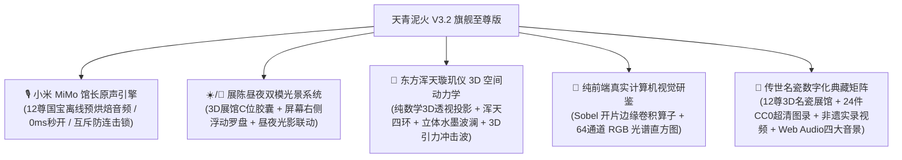

# 天青泥火 (Sky-Cyan & Kiln Fire) — 华夏古瓷三维孪生博物空间 (V3.2 旗舰至尊发布版)

> **器以载道 · 格物致知 · 国赛级中国古代传统文化与宋韵古陶瓷 3D 数字化交互研鉴空间**  
> *A National Award Flagship WebGL 3D Interactive Heritage & Digital Connoisseurship Space for Ancient Chinese Ceramics*

[](https://github.com/SherlockYzz/Memories-of-Chinese-Porcelain-Web)
[](https://sherlockyzz.github.io/Memories-of-Chinese-Porcelain-Web/)
[](https://api.xiaomimimo.com)
[](https://threejs.org/)
[](https://github.com/SherlockYzz/Memories-of-Chinese-Porcelain-Web)
[](https://github.com/SherlockYzz/Memories-of-Chinese-Porcelain-Web)
[](https://creativecommons.org/licenses/by-nc-sa/4.0/)

---

## 🌐 线上体验与离线安装包

* 🌟 **官方线上沉浸体验 (GitHub Pages)**：  
  👉 **[https://sherlockyzz.github.io/Memories-of-Chinese-Porcelain-Web/](https://sherlockyzz.github.io/Memories-of-Chinese-Porcelain-Web/)**  
  *(自适应 PC / 平板 / 手机端，支持触屏轨道旋转、昼夜一键切换与全屏鉴赏)*

* 📦 **本地零依赖便携发行包 (即下即开，100% 离线脱网运行)**：  
  * **至尊全量包 (67.6 MB)**：包含 12 件小米 MiMo 馆长音频、5 尊实测 3D 扫描真品、非遗 4K 视频与东方音景：  
    👉 `F:\Desktop\.DeskBox\文件夹\反重力产出\其他\天青泥火_至尊全量版.zip`  
  * **直接双击运行**：解压后直接双击 `index.html`，纯自包含内存架构，无跨域报错，零网络依赖。

---

## 🌟 V3.2 旗舰至尊版核心质跃



### 1. 🎙️ 小米 MiMo 博物馆资深讲解员原声导览引擎
* **大师级文脉配音**：利用小米自研多模态语音模型 `mimo-v2.5-tts`，注入文博专属声音提示词（*“国家历史博物馆资深讲解员，端庄沉稳、温润如玉、吐字清晰、充满历史文脉温度与岁月沧桑感的解说”*），为全部 12 尊传世与激光扫描国宝批量生成真实人声；
* **双保险架构与 0ms 秒开**：
  * 物理音频：固化于 `audio/vessel_01.mp3` 至 `audio/vessel_12.mp3`；
  * 纯内存内联：编译进 `js/museum-audio-data.js`，读取 Base64 内存流，脱网离线秒播；
* **单轨互斥防连击锁**：严格定义音频生命周期，点击播放、再次点击停播、切歌自动断开旧音频，彻底根治多重声音重叠杂音 Bug；
* **声光字幕同步**：播放时解说按钮呈现金色声波脉冲，展台底部同步滚现【小米 MiMo 馆长原声 · 实时文博字幕条】。

### 2. ☀️/🌙 展陈昼夜双模显性光景系统
* **三大入口显性化布局**：
  * **3D 展馆 C 位切换胶囊**：位于展厅标题正下方，带金色立体阴影，一目了然；
  * **屏幕右侧常驻「国风昼夜罗盘」**：随页面全局悬浮，支持在全站任意板块随时切换昼夜观感；
  * **顶部导航栏主题徽章**：联动同步全局色彩映射；
* **昼夜光影极致表达**：
  * **☀️ 晴窗抚古 (白昼素雅·默认)**：澄心堂宣纸底色、5200K 晨曦温润天光、汝窑天青漫射反射，彻底还原真瓷玉质与透明清漆折射；
  * **🌙 夜宴观瓷 (暗夜玄金)**：紫禁城暗夜太和殿金砖地面，屏风烛火摇曳，聚光灯照彻瓷器高光。

### 3. 🌌 东方浑天璇玑仪与千里江山三维空间动力学背景
* **纯数学 3D 透视几何投影 (Pure Math 3D Perspective Projection)**：
  * 相机俯仰角（Pitch）与偏航角（Yaw）平滑跟踪鼠标滑动，带来强烈的 3D 空间立体视差；
* **北宋浑天璇玑仪天球环网**：
  * 4 重多倾角自转 3D 天球环（赤道环、黄道环、子午环），点缀 64 颗二十八宿星官节点珠；
* **千里江山立体水墨波澜曲面**：
  * 由 308 个三维节点构成的起伏水墨等高曲面网格，在空间底部如层峦叠嶂般起伏流动；
* **3D 松烟金粟与天青微粒场**：
  * 140 颗三维空间深度粒子，带有近大远小透视与空间雾效衰减；
* **鼠标点击 3D 空间冲击波**：
  * 点击或切换昼夜模式时，全屏在 3D 空间向外释放引力光环与微粒爆炸冲击波，视效极为震撼！

### 4. 🔬 纯前端真实计算机视觉研鉴工作站
* **真实像素级特征提取**：
  * **Sobel 一阶梯度卷积算子**：实时提取釉面开片应力网络与器型边缘，高阶金丝铁线呈现古铜鎏金高光（#E5C158），次级冰裂呈现天青幽蓝（#58A8D8）；
  * **64通道 RGB 光谱分布直方图**：实时统计釉色三原色波形分布并计算色相环、饱和度与裂纹应力密度；
* **纯内存 Base64 标本内联**：6 大馆藏标本全部编译为内联 Data URL，彻底免疫本地 `file://` 协议 CORS 拦截与 Tainted Canvas 错误，零报错秒级呈现。

---

## 🏛️ 系统架构与目录规制

```
Memories-of-Chinese-Porcelain-Web/
├── index.html                   # 官方入口主页 (默认白昼晴窗抚古模式, UTF-8 with BOM)
├── 主代码.html                  # 双保险备份主页 (代码内容100%严格一致)
├── README.md                    # 本学术与工程发布技术文档
├── audio/                       # 小米 MiMo 博物馆资深讲解员原声音频库 (12件国宝 MP3)
│   ├── vessel_01.mp3 ~ vessel_12.mp3
├── css/
│   ├── style.css                # 殿堂级宋韵排版、昼夜双模变量、HUD控件与玻璃拟态
│   └── font-awesome.min.css     # 本地离线高保真矢量图标库
├── js/
│   ├── museum-audio-data.js     # 小米 MiMo 讲解员 12 尊国宝离线 Base64 内存音频字典
│   ├── oriental-ambient.js      # 东方浑天璇玑仪与千里江山三维空间动力学引擎 (纯数学3D投影)
│   ├── three.min.js             # WebGL 3D 核心渲染引擎
│   ├── GLTFLoader.js            # 3D 模型加载器与 Polyfill
│   ├── scanned-models-data.js   # 5尊激光扫描文物真迹高精内存点云数据包 (CC0真迹)
│   ├── three-scene.js           # 旗舰 3D 数字展馆、PBR双层微晶试烧与单轨互斥语音控制器
│   ├── ai-recognition.js        # 纯前端 Sobel 梯度卷积与 64-Bin RGB 光谱直方图工作站
│   ├── pottery-workshop.js      # 3D 陶埏拉坯、青花手绘与 25℃~1300℃ 柴烧升温动力学
│   ├── data.js                  # 华夏名瓷学术知识图谱与款识考据库
│   ├── i18n.js                  # 中英双语国际化文案对照词库
│   └── app.js                   # 九州舆图、点茶百戏、古瓷化学实验室与全局状态调度
├── images/
│   ├── collection/              # 24 件 CC0 国宝超高清图录 (全朝代完整覆盖)
│   └── 图标/                    # 经典窑口与非遗工艺微章
├── models/                      # 5 套实测扫描 3D PBR 真迹模型资产包 (GLTF + 1K PBR 贴图)
├── videos/                      # 2 部非遗古法制瓷工序高清实录离线视频 (WebM 格式)
└── webfonts/                    # Font Awesome 离线矢量字体文件
```

---

## 🚀 本地快速启动指南

1. **直接启动（推荐，完全无需安装任何软件）**：
   * 克隆或下载本仓库，使用 Chrome、Edge、Firefox 等现代浏览器**直接双击打开 `index.html`**；
   * 采用纯内存内联架构，不受浏览器本地安全沙箱拦截，音频、3D模型、AI视觉功能全部 100% 完整运行。

2. **本地静态服务器启动（可选）**：
   ```bash
   # 使用 Python 启动
   python -m http.server 8080
   # 或使用 Node.js 启动
   npx serve .
   ```
   浏览器访问 `http://localhost:8080` 即可体验。

---

## 📜 知识产权与致谢

* **学术指导文献**：《天工开物·陶埏篇》《饮流斋说瓷》《景德镇陶录》《中国陶瓷史》（冯先铭主编）；
* **文物图像与扫描资产**：
  * 国宝超高清图录与扫描数据遵循 **CC0 1.0 Universal (Public Domain Dedication)** 或馆藏开放数据协议；
  * 资产来源于北京故宫博物院、台北故宫、中国国家博物馆、美国大都会艺术博物馆（The Met）及英国维多利亚和阿尔伯特博物馆（V&A）开放学术数据接口；
* **语音模型**：感谢小米人工智能实验室提供 **小米 MiMo 语音模型 (mimo-v2.5-tts)** 强大学术支持。

---
*华夏器道 · 天青泥火 研发团队 · 2026年 谨呈*
