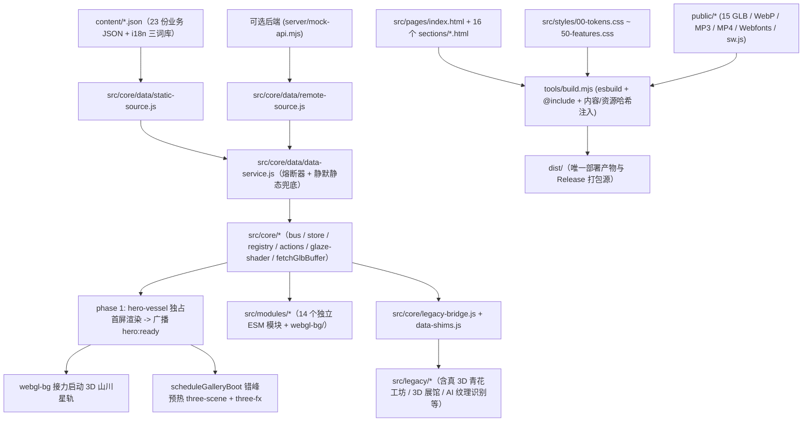

# 天青泥火 (Tianqing Nihuo) — 华夏古瓷三维研学空间 (v9.2.0)

> **从泥到火，从器到鉴——数字化复原中国古瓷的一生**  
> *Tianqing Nihuo: From Clay to Fire, From Vessel to Connoisseurship — A 3D Study Space for Ancient Chinese Ceramics*

[](https://sherlockyzz.github.io/Memories-of-Chinese-Porcelain-Web/)
[](https://github.com/SherlockYzz/Memories-of-Chinese-Porcelain-Web/releases/latest)
[](https://hub.xerj.org/contributors/SherlockYzz)
[](https://threejs.org/)
[](https://github.com/SherlockYzz/Memories-of-Chinese-Porcelain-Web)
[](docs/ARCHITECTURE.md)
[](LICENSE)

---

## 一、在线访问与最新版本整合包

- **GitHub Pages 在线研学**：https://sherlockyzz.github.io/Memories-of-Chinese-Porcelain-Web/  
  由 GitHub Actions（[.github/workflows/deploy-pages.yml](.github/workflows/deploy-pages.yml)）在每次推送 `main` 时自动执行全量静态校验与确定性生产构建，部署纯静态站点。
- **GitHub Releases 离线整合包（v9.2.0）**：https://github.com/SherlockYzz/Memories-of-Chinese-Porcelain-Web/releases/latest  
  每次打标签由 [.github/workflows/release.yml](.github/workflows/release.yml) **清空历史缓存后全量冷构建**，输出最新 `TianQingNiHuo.zip`（完整 `dist/` 纯静态网站包）与 `SHA256SUMS.txt` 校验文件，并**自动清退历史旧版 Release 与旧 Tag**；解压后通过任意静态 HTTP 服务器即可完整离线运行。
- **官方索引收录**：本项目纯前端 WebGL 物理釉面着色与三维研学架构已被全球 AI 原生代码语料库 [XERJ Corpus Hub](https://hub.xerj.org/contributors/SherlockYzz) 官方收录。

---

## 二、网页全量功能详解（五大篇章 + 全局能力）

网站以 **“从泥到火，从器到鉴”** 为主线，组织为 **全局体验与性能系统 + 五大递进研学篇章**：

### 0. 全局体验与极速渲染引擎
- **双端秒开与零抢占三路 WebGL 错峰调度**：
  - 首屏（`Hero3D`）优先独占 GPU 与网络管线，在首帧材质就绪后通过应用总线广播 `hero:ready` 事件，依次放行底层背景 `webgl-bg` 与次屏三维展馆 `initThreeJS()`；
  - 用 **亚毫秒 `CubeTexture` 博物馆柔光环境（`createStudioCubeEnv`）** 替代耗时数秒的同步 `PMREMGenerator` 卷积，配合 **256×256 双层 Voronoi 距离场缓存** 与 **全站共享 `ArrayBuffer` 内存缓存（`fetchGlbBuffer`）**，消除 0 号宋官窑模型重复拉取，在主馆稳固后通过低频单路二进制静默预热提前缓存 1–8 号 `.glb` 数据，兼顾移动端低功耗流畅切换与电脑端高画质秒开；
  - 首屏必载脚本与样式控制在约 `1483 KB`，其余重型工坊、AI 视觉检测与英文大词典（`655.7 KB`）全部按需懒加载；配合 `Service Worker`（`public/sw.js`，`tianqing-nihuo-v9.2-fast`）短内容哈希缓存隔离与模型超时重试，保障图文音模全量快速稳定加载。
- **全局 3D 自动律动水墨山川背景（`src/modules/webgl-bg/`）**：WebGL 背景千里江山等高线曲面与北宋浑天仪星轨支持根据视口/硬件自动三档分级（`high/medium/low`）与动态 FPS 降级，具备**自主利萨茹呼吸微震律动与自动等高线涟漪**，并实时与鼠标悬停、点击脉冲及滚动视差丝滑叠加。
- **全站无障碍与高效导览**：
  - **3 分钟自动研学导览**（`src/modules/guided-tour.js`）：一键沉浸式串联全站重要展区与语音导览；
  - **统一指令面板 `Ctrl+K`**：快速检索全站 26 件馆藏、窑口与交互实验并直达跳转；
  - **中英双语瞬时切换**（`src/core/i18n.js`）：核心 UI 键（77 组）零延迟切换，全量精准词库（`2620` exact / `2695` phrases）按需加载；
  - **适老与无障碍面板**（`src/modules/a11y-panel.js`）：字号分级放大、高对比度模式、减弱动画与 Web Speech 语音朗读；
  - **浅/深色主题切换**（`src/modules/theme.js`）与 **PWA 离线安装支持**（`src/modules/pwa.js`）。

### 序 · 器道序厅（`src/pages/sections/hero.html`、`src/modules/hero-vessel.js`）
- **首屏官窑天青瓶实时 3D 精鉴**：进入主页即展示 Blender 参数化复原的南宋官窑八方贯耳弦纹瓶与实时开片微距观察镜，支持拖拽 360° 把玩、微观釉面与紫口铁足展示。

### 第一幕 · 识器（观其形、辨其釉、察其纹）
1. **数字孪生 3D 立体展馆（`src/pages/sections/3d-gallery.html`、`src/legacy/three-scene.js`、`src/legacy/three-fx.js`）**：
   - 收录 **15 件三维古瓷资产**（10 件基于传世名窑经典器型与尺寸文献通过 Blender 5.2 参数化重建并烘焙贴图 + 5 件 Poly Haven CC0 陶瓷对照标本）与 **宋代雅室 PBR 环境道具**（红木展示案、千里江山六曲屏风、紫檀展台、三足铜香炉）。
   - **博物馆级精绘重点器物釉面复原**：对北宋钧窑玫瑰紫釉海棠出戟尊（红紫蓝乳光交融窑变）、元青花缠枝牡丹龙纹大罐（苏麻离青沉郁铁锈结晶缠枝纹饰）、明宣德祭红釉僧帽壶（宝光内蕴深茜红配口沿「灯草边」露白）、清乾隆黄地洋彩开光转心瓶（明黄锦地轧道配双边框开光折枝花卉）提供 `1024×512` 专属高清程序釉画绘制与干净馆藏图录缩略图；
   - 支持 **宋代雅室 / 文博殿堂 / 御窑幽室** 三套光照场景、`onBeforeCompile` 双层微晶清漆着色、积釉深浅渐变、官窑「紫口铁足」、建窑曜变虹彩、**9 柜 3D 全景漫游**、**X 光纵向剖切**、**82° 翻转鉴底**（真篆体落款）、**双器同台并列比对**、**叩瓷共振声波波形**与 **100x 光学景深显微镜**。
2. **WebXR / 桌面 1:1 实尺对照台（`src/modules/ar-viewer.js`）**：
   - 自动检测设备 `immersive-ar` 能力；桌面端提供 **15 cm 智能手机 / 7 cm 茶盏 / 30 cm 标尺** 同台 1:1 物理尺寸参照与对比海报导出。
3. **名器典藏图录（`src/pages/sections/archive.html`、`src/modules/archive-catalog.js`）**：
   - 汇聚 **26 条馆藏档案**，支持朝代/窑系多维检索、CC0 对照标本筛选、一键跳转对应 3D 鉴赏视角及十二件名瓷导览原声播放。
4. **前端像素级釉面纹理实验室（`src/pages/sections/ai-recognition.html`、`src/legacy/ai-recognition.js`）**：
   - 上传或选用器物图片，在纯浏览器端实时演算 **RGB/HSL 色彩直方图** 与 **Sobel 边缘梯度热力图**，辅助直观理解胎釉光影与开片纹理分布。

### 第二幕 · 造物（泥坯、青花、窑火与修补）
1. **真 3D Three.js 互动拉坯与手绘青花数字工坊（`src/pages/sections/pottery-studio.html`、`src/legacy/pottery-workshop.js`）**：
   - **真三维车削实体建模**：基于 88 段 `CatmullRomCurve3` 与 `THREE.LatheGeometry` 构造含口沿厚度与深邃内腔的双层实体瓷坯，配合 `MeshPhysicalMaterial`（`clearcoat: 1.0`）、柔和摄影棚环境反射与真实拉坯轮痕凹凸法线；提供「向内收束 / 向外鼓腹 / 跟随修光」塑形与宋定窑梅瓶、玉壶春瓶、大吉葫芦瓶、建窑斗茶盏等经典官样模版，实时计算器高、口径、腹径、容积与宋韵美学评分；
   - **高精 `1024×512` UV 与 `Raycaster` 曲面绘瓷**：依托三维射线拾取精确映射到圆柱 UV 贴图，支持 **笔速压感调控线宽与墨韵深浅**、**转盘定格 / 旋转绘制**、**单笔 / 4 重对称 / 6 重对称** 旋转镜像绘制，以及 **勾线、分水、点斑（苏麻离青铁锈斑）、点印（莲瓣 / 折枝梅 / 卷云 / 回纹四大青花印章）、刮料、毫锋粗细调节**；
   - **秘制矿物釉与 1300℃ 窑变 + 草稿存档**：内置 **雨过天青、龙泉粉青、官窑月白、景德镇永宣甜白釉（无开片洁净玉釉）、钧窑玫瑰紫、建盏乌金兔毫** 6 款釉色；提供 **重置视角**、浏览器 `localStorage` **暂存 / 读档**、`Ctrl+Z` 泥坯/笔触同步撤销、1300℃ 松柴还原焰烧成全过程（未烧前青花呈灰青哑光泥料，出窑后融为釉下莹澈宝蓝与物理清漆高光），并可落款四字朱文方印、导出高分辨率造物典藏海报。
2. **1300℃ 烧成全过程物相与呈色时间轴（`src/modules/firing-timeline.js`）**：
   - 八阶段（25℃、120℃、500℃、573℃ α-β石英相变、950℃ 素烧、1150℃ 液相、1250℃ CO 强还原焰 $\text{Fe}^{3+}\to\text{Fe}^{2+}$、1300℃ 玻化定型）交互式时间轴与胎釉实时色板演进。
3. **过手七十二工序与釉色化学实验（`workshop.html`、`colors.html`）**：
   - 拆解传统制瓷工艺脉络与五大名窑典型釉色矿物发色规律。
4. **双尺度 Voronoi 冰裂开片过程模拟器（`src/pages/sections/crackle-lab.html`、`src/modules/crackle-lab.js`）**：
   - 调节 **胎釉热膨胀系数差（Δα）/ 釉层厚度 / 冷却速率**，实时生成金丝铁线双尺度裂纹网格，依托共享 `AudioContext` 合成清脆出窑开片声景并导出高清标本卡。
5. **古瓷金缮修复互动工坊（`src/pages/sections/kintsugi.html`、`src/modules/kintsugi-game.js`）**：
   - 升级 **天然锯齿状随机断裂缝隙（`makeJaggedPath`）** 与 **暗漆垫底 + 泥金碎屑闪光颗粒** 渲染，支持碎片拖拽与磁吸拼合、选择 **泥金 / 银缮 / 朱漆描金** 工艺并导出修复完工证书。
6. **空灵瓷韵 · 古瓷五声编磬（`pottery-studio.html` & `pottery-workshop.js`）**：
   - 点击宫、商、角、徵、羽琴键或按键盘 `1–5` 键，基于 Web Audio API 物理泛音合成聆听不同窑口胎骨共振清音。

### 第三幕 · 入境（历史长河、窑口版图、点茶与声景）
- **八千年华夏陶瓷通史长卷**（`history.html`）与 **九州名窑地理分布交互图谱**（`kiln-map-section.html`）；
- **宋代文人四艺（焚香、点茶、挂画、插花）与七汤点茶百戏**（`four-arts.html`）；
- **视听研学影院与东方声景**（`video-theatre.html`、`src/legacy/oriental-ambient.js`）：按需流式加载影像与古琴泛音、雨打芭蕉环境声景。

### 终 · 问学（文献短札、博古殿试、研学护照与致谢）
- **三篇学术短札**（`notes.html`、`content/notes.json` 含内联 SVG 物理原理解析图）；
- **十二道博古殿试**（`content/quiz.json` 支持即时判分与研学成绩单导出）；
- **四幕研学护照**（`passport.html`、`src/modules/passport.js`）：随浏览 3D 展馆、完成 1300℃ 窑烧、开片实验、金缮修复与殿试自动点亮 8 枚朱文印章并导出署名结业证书；
- **《素材与致谢》专题板块**（`credits.html`、`src/modules/credits.js`、`content/credits.json`）。

---

## 三、完整代码架构解析

项目采用 **Vanilla ESM + esbuild 确定性构建 + JSON 内容驱动** 单源码架构，结合总线式三阶段生命周期与零抢占渲染管线：



### 1. 分层目录与核心模块职责
- **`content/`（唯一内容与多语言真源）**：
  - 23 份结构化业务 JSON（`vessels.json`、`archive.json`、`glazes.json`、`reference-colors.json`、`scene.json`、`crackle-lab.json`、`kintsugi.json`、`firing-timeline.json`、`passport.json`、`credits.json`、`quiz.json`、`notes.json`、`kilns.json`、`history.json`、`workshop-steps.json`、`literati-arts.json`、`microscope.json`、`comparison.json`、`pentatonic.json`、`reign-marks.json`、`colors.json`、`navigation.json`、`site.json`）；
  - `content/i18n/`：`ui.json`（77 组核心界面键值）+ `en.exact.json` & `en.phrases.json`（英文词典）。
- **`src/core/`（零业务逻辑工程内核）**：
  - `bus.js` / `store.js` / `storage.js`：跨模块发布订阅总线（`AppBus`，承担 `hero:ready` 错峰时序同步）与持久化状态管理；
  - `registry.js`：三阶段模块生命周期管理（`phase 1` 首屏、`phase 2` 次屏、`phase 3` 空闲期）与资源自动回收；
  - `actions.js`：全站唯一声明式 `[data-action]` 事件委托分发器（零内联 `onclick`）；
  - `lazy.js`：按逻辑分块名触发懒加载（`IntersectionObserver` 接近视口或 `requestIdleCallback` 闲时加载）；
  - `index.js`：聚合导出内核 API，并提供全站共享的 `fetchGlbBuffer(url)` `ArrayBuffer` 内存去重缓存池；
  - `glaze-shader.js`：Three.js 物理釉面扩展引擎，提供双尺度 Voronoi 距离场缓存（`256×256` + `128×128` 橘皮微法线）、`createStudioCubeEnv()` 亚毫秒 6 面柔光立方体贴图（独立纹理实例供各 `WebGLRenderer` 安全使用），以及 `onBeforeCompile` 积釉厚薄与紫口铁足着色增强；
  - `data/data-service.js`：统一异步数据层，支持自动检测可选后端与零感知静态 JSON 兜底；
  - `i18n.js`、`modal.js`、`toast.js`、`dom.js`、`legacy-bridge.js`、`global-shim.js`。
- **`src/modules/`（14 个标准 ESM 独立模块 + `webgl-bg/`）**：
  - `theme.js`、`navigation.js`、`guided-tour.js`、`hero-vessel.js`、`archive-catalog.js`、`crackle-lab.js`、`kintsugi-game.js`、`firing-timeline.js`、`ar-viewer.js`、`passport.js`、`a11y-panel.js`、`credits.js`、`pwa.js`、`index.js` 及 `webgl-bg/` 三维背景引擎（内含移动端触控降阶保护）。
- **`src/legacy/`（富交互核心引擎与兼容层）**：
  - `three-scene.js`、`three-fx.js`（含展馆稳固后单路纯二进制 `warmBufferTick` 静默预抓取）、`pottery-workshop.js`（真 3D Three.js 车削工坊 + `1024×512` `Raycaster` 青花绘瓷）、`ai-recognition.js`、`oriental-ambient.js`、`data-shims.js`、`ui-enhance.js`。
- **`src/styles/`（单一视觉令牌样式体系）**：
  - `00-tokens.css`（集中管理全站色彩、`--z-*` 层级、阴影与 `.section-surface` 透纱透明度）→ `10-layout.css` → `20-nav.css` → `30-hero.css` → `40-sections.css` → `50-features.css` 及 `legacy/`。
- **`tools/` 与构建分块产物（`tools/build.mjs` & `tools/build.config.mjs`）**：
  - 确定性构建输出：**首屏必载** `vendor-icons.css` + `app.css` + `vendor.js` + `legacy.js` + `app.js` + `index.html`（共约 `1482.5 KB`），以及 **4 个按需懒加载分块**：`legacy-pottery`（`47.0 KB`）、`legacy-ambient-2d`（`6.1 KB`）、`legacy-ai`（`422.8 KB`）、`i18n-en`（`655.7 KB`），所有文件均注入短内容哈希以配合 `sw.js` 缓存隔离。

### 2. 四维质量门禁与自动化运维流水线
- **`npm run check`**（`tools/check.mjs`）：串行执行 `check-content`（JSON 必填字段与 152+ 静态资源实存）、`check-i18n`（中英词条严格对齐与 HTML 键覆盖）、`check-style`（现代样式零违规与 `!important` 计数守护）与 `check-code`（禁用内联事件、禁用 emoji、禁用 ESM 模块挂载全局 `window` 变量）。
- **`npm run test` / `npm run test:visual`**（`tests/run.mjs`）：使用 Playwright 在无头浏览器中实测 **1280 / 1440 / 1920 桌面端与 390px 移动端**的浅/深双主题，校验零控制台错误、零 404、零横向与顶栏溢出、背景透出、创新模块弹窗与无后端兜底。
- **双路 GitHub Actions**：`.github/workflows/deploy-pages.yml`（推送 `main` 即部署 Pages）与 `.github/workflows/release.yml`（推送 `v*` 标签即全量冷构建、校验、打包 `TianQingNiHuo.zip` 并自动清理历史旧版 Release 与旧 Tag）。

---

## 四、本地开发与构建命令

需 **Node.js >= 20**（构建与静态检查零浏览器依赖；Playwright 回归需本地 Chrome/Chromium 与 `playwright-core`）：

```bash
# 安装开发依赖
npm install

# 启动监听增量构建与本地预览服务
npm run dev

# 清空重建带内容哈希的纯静态产物至 dist/
npm run build

# 全量四维静态工程校验
npm run check

# 运行 Playwright 全量 E2E 回归断言
npm run test

# 审计全站 GLB 模型面数与贴图体积 -> reports/model-audit.md
npm run audit:models
```

---

## 五、正面致谢与学术典据

谨向为本项目提供开源模型、学术研究文献、语音合成与图形学基础工具的学者与社区致以诚挚敬意（完整条目见 [content/credits.json](content/credits.json)）：

- **三维模型与数字复原**：原创十件名窑传世器型参数化复原及宋代雅室展陈道具（Blender 5.2 PBR）；致谢 **Poly Haven**（James Ray Cock）提供 5 件 CC0 公共领域陶瓷三维参考模型。
- **权威学术文献与古籍参考**：
  - 中国硅酸盐学会主编《中国陶瓷史》（文物出版社，1982）
  - 李家治主编《中国科学技术史·陶瓷卷》（科学出版社，1998）
  - W. D. Kingery & P. B. Vandiver, *Ceramic Masterpieces* (Free Press, 1986)
  - Nigel Wood, *Chinese Glazes* (A&C Black, 1999)
  - 古籍文献：《天工开物·陶埏》《大观茶论》《饮流斋说瓷》《景德镇陶录》
- **声景、语音与开源基础设施**：致谢小米人工智能实验室 **MiMo 语音模型（`mimo-v2.5-tts`）** 提供十二件名瓷典藏语音导览，以及 Web Audio API、Three.js、Tailwind CSS 等开源图形生态。

---

## 六、版本更新历史 (Changelog)

- **v9.2.0 (2026.11)**：
  - **真 3D Three.js 拉坯与青花绘瓷工坊重构**：升级 88 段 `CatmullRomCurve3` + `LatheGeometry` 实体瓷坯与 `MeshPhysicalMaterial` 清漆反光，搭载 `Raycaster` `1024×512` 曲面拾取绘制、笔速压感、4/6 重镜像对称、莲瓣/梅枝/云纹/回纹四大青花印章、重置视角与 `localStorage` 草稿暂存/读档；
  - **4 件博物馆级馆藏釉面重绘与纯净图录焕新**：精绘北宋钧窑玫瑰紫窑变、元青花缠枝牡丹龙纹罐、明宣德宝石红祭红釉僧帽壶（「灯草边」露白）、清乾隆黄地洋彩开光转心瓶程序纹理与 `512×512` 纯净馆藏缩略图；
  - **全端加载与渲染性能飞跃**：用亚毫秒 `createStudioCubeEnv()` 立方体环境贴图彻底移除同步 `PMREMGenerator` 卡顿，Voronoi 距离场预计算缓存降维提速，`hero:ready` 总线错峰门控三路 WebGL 上下文，全端实现稳态后纯二进制 `fetchGlbBuffer` 静默预拉，无头软件光栅实测桌面端首屏 3D 提速至约 4.4s、移动端首屏 3D 提速至约 2.0s；
  - **细节体验全面打磨**：升级金缮天然锯齿裂纹与金箔微粒质感、共享 `AudioContext`、补全 18 组双语工坊词汇并更新 `sw.js` 至 `tianqing-nihuo-v9.2-fast`。
- **v9.1.0 (2026.11)**：升级 360° 柱面 UV 青花引擎与永宣甜白釉，优化首屏预载与 3D 自动律动山川背景，建立 GitHub Release 自动清旧发版流水线。
- **v9.0.0 (2026.11)**：完成 `src/` + `content/` + `public/` → `dist/` 单源码确定性架构重构与五大创新研学模块落地。
- **v8.0.0 – v5.0.0**：完成 WebGL 3D 交互背景、Blender 5.2 PBR 资产构建与 1024 WebP 轻量化、双器对比与 100x 光学景深显微镜等基础能力建设。

---

**版权制作：折木柯南** · 开源许可协议：[CC BY-NC-SA 4.0](LICENSE)
