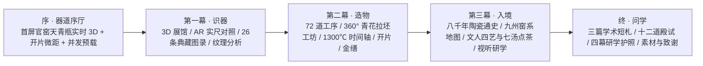

# 天青泥火 (Tianqing Nihuo) — 华夏古瓷三维研学空间 (v9.1)

> **从泥到火，从器到鉴——数字化复原中国古瓷的一生**  
> *Tianqing Nihuo: From Clay to Fire, From Vessel to Connoisseurship — A 3D Study Space for Ancient Chinese Ceramics*

[](https://sherlockyzz.github.io/Memories-of-Chinese-Porcelain-Web/)
[](https://github.com/SherlockYzz/Memories-of-Chinese-Porcelain-Web/releases/latest)
[](https://hub.xerj.org/contributors/SherlockYzz)
[](https://threejs.org/)
[](https://github.com/SherlockYzz/Memories-of-Chinese-Porcelain-Web)
[](docs/ARCHITECTURE.md)
[](LICENSE)

---

## 在线体验与离线发布包

- **GitHub Pages 在线访问**：https://sherlockyzz.github.io/Memories-of-Chinese-Porcelain-Web/  
  由 GitHub Actions（[.github/workflows/deploy-pages.yml](.github/workflows/deploy-pages.yml)）自动执行 `npm run check && npm run build` 并将纯静态产物部署至 Pages；支持桌面端 `1280 / 1440 / 1920` 与移动端 `390px` 自适应、中英双语瞬时切换、PWA 离线壳缓存与适老无障碍模式。
- **GitHub Releases 免构建整合包**：https://github.com/SherlockYzz/Memories-of-Chinese-Porcelain-Web/releases/latest  
  每次打版本标签自动打包完整 `dist/` 产物为 `TianQingNiHuo.zip`（附 `SHA256SUMS.txt`），解压后用任意静态 HTTP 服务器（如 `npx serve .` 或 `python -m http.server`）即可直接运行。
- **入选全球 AI 原生代码语料库 ([XERJ Corpus Hub](https://hub.xerj.org/contributors/SherlockYzz))**：  
  本项目纯前端 WebGL 物理釉面着色与三维研学工程架构获开源搜索项目 [XERJ](https://github.com/xerj-org/xerj) 官方索引收录。

---

## 核心特色与近期升级亮点 (v9.1)

1. **首屏秒开与全量并发预载**：
   - 优化首屏渲染关键路径与异步资源调度，结合按需动态分块加载、`Service Worker`（`public/sw.js`）缓存隔离与 GLB 三维模型超时自动重试机制，兼顾移动端与桌面端的瞬开体感及全量图录图片/三维资产完整性。
2. **360° 柱面 UV 青花工坊与永宣甜白釉**：
   - 将 [pottery-workshop.js](src/legacy/pottery-workshop.js) 与 [pottery-studio.html](src/pages/sections/pottery-studio.html) 重构为 512×256 双层柱面 UV + 32 扇条半球透视投影引擎，随 44 层拉坯器身曲线无缝包裹旋转。
   - 新增 **勾线 / 分水 / 点斑（苏麻离青铁锈斑）/ 刮料** 四大笔法、`细/中/粗` 毫锋切换、**转盘定格**、`Ctrl+Z` 泥坯与手绘双撤销、`1300℃` 窑烧生坯灰青向釉下宝蓝蜕变动画，以及 **景德镇永宣甜白釉（无开片洁净釉面）** 与高清典藏证书导出。
3. **全局 3D 水墨山川自动律动与交互叠加**：
   - `src/modules/webgl-bg/` 全局背景在自主呼吸律动与微震波渲染的同时，与鼠标/触控交互和页面滚动视差自然叠加；配合 `00-tokens.css` 与 `.section-surface` 透纱层，兼具通透景深与高可读性。
4. **学术典据建模与物理釉面着色**：
   - 10 件核心名窑器物（`public/models/masterpieces/*.glb`）基于传世公开器型与尺寸文献以 Blender 5.2 参数化精密重建（内置 `1024×1024` WebP 烘焙贴图），搭配 5 件 Poly Haven CC0 陶瓷对照标本与 4 件宋代雅室 PBR 环境道具；`glaze-shader.js` 实现双层微晶透光清漆、积釉厚薄、官窑紫口铁足渐变与多尺度 Voronoi 冰裂纹，通过 CIELab ΔE2000 量化校色。

---

## 四幕递进式研学体验架构

项目以 **“从泥到火，从器到鉴——数字化复原中国古瓷的一生”** 为叙事主线：



### 全站板块速览
- **序厅 & 全局能力**：3 分钟自动导览（`guided-tour.js`）、全局 3D 自动律动水墨山川与浑天星轨背景（`webgl-bg/`）、`Ctrl+K` 指令面板、浅/深主题及无障碍适老面板（`a11y-panel.js`）。
- **第一幕 · 识器**：3D 展馆（三光景切换、X 光剖切、82° 翻转鉴底、双器对比与 100x 显微镜）、WebXR / 桌面 1:1 实尺对照台（`ar-viewer.js`）、26 件名器图录（`archive-catalog.js`）与像素级 Sobel 纹理分析（`ai-recognition.js`）。
- **第二幕 · 造物**：44 层指尖拉坯与 360° 柱面手绘青花数字工坊（`pottery-workshop.js`）、`1300℃` 八阶段烧成物相时间轴（`firing-timeline.js`）、釉色化学实验（`glaze-chemistry.js`）、双尺度 Voronoi 开片声景实验室（`crackle-lab.js`）与金缮修复互动工坊（`kintsugi-game.js`）。
- **第三幕 · 入境 & 终 · 问学**：通史长卷、九州窑系地理图、宋代七汤点茶百戏、视听研学影院、三篇带 SVG 原理图的学术短札（`notes.json`）、十二道殿试（`scholar-exam.js`）、四幕研学护照（`passport.js`）与 [《素材与致谢》](src/pages/sections/credits.html)。

---

## 工程分层与目录结构

```text
Memories-of-Chinese-Porcelain-Web/
├── .github/workflows/
│   ├── deploy-pages.yml                # GitHub Pages 自动校验、构建与部署
│   └── release.yml                     # v* 标签自动打包 dist/ 并发布 GitHub Release
├── content/                            # JSON 业务数据与中英双语词库（i18n/）
├── src/
│   ├── core/                           # bus / store / registry / actions / i18n / glaze-shader / lazy
│   ├── modules/                        # 14 个独立 ESM 业务模块 + webgl-bg/
│   ├── legacy/                         # 渐进兼容层（含 360° 柱面 UV 青花拉坯工坊）
│   ├── pages/                          # 单一 HTML 入口与 sections/ 分片模板
│   └── styles/                         # 00-tokens.css + 模块化层级样式
├── public/                             # 3D GLB 模型、图片、音频、视频、字体与 sw.js
├── dist/                               # esbuild 确定性生产构建输出目录
├── tools/                              # build.mjs / check*.mjs / audit-models.mjs / verify-glaze-colors.mjs
├── tests/                              # Playwright E2E 回归（run.mjs）与多视口截图（shots.mjs）
├── docs/                               # ARCHITECTURE.md / MIGRATION.md / COMPETITION_PACK.md / ITERATION_PROMPT.md
└── reports/                            # model-audit.md / glaze-color-verify.md
```

---

## 本地开发、构建与自动化校验

需要 **Node.js >= 20**（构建与静态检查零浏览器依赖；E2E 回归依赖 Chrome/Chromium 与 `playwright-core`）：

```bash
# 安装开发依赖
npm install

# 启动本地热构建与预览服务
npm run dev

# 生成带内容哈希的纯静态发布包至 dist/
npm run build

# 全量静态工程校验（内容字段 / 中英 i18n 对齐 / 样式层级 / 代码规范）
npm run check

# 运行 Playwright 全量 E2E 回归（1280/1440/1920 桌面与 390 移动端零溢出、零报错与核心交互测试）
npm run test

# 审计 GLB 面数/贴图体积 -> reports/model-audit.md
npm run audit:models
```

---

## 正面致谢与学术典据

谨向为本项目提供开源模型、学术研究文献、语音合成与图形学基础工具的学者与社区致以诚挚敬意（完整条目见 [content/credits.json](content/credits.json)）：

- **三维模型与数字复原**：原创十件名窑传世器型参数化复原及宋代雅室展陈道具（Blender 5.2 PBR）；致谢 **Poly Haven**（James Ray Cock）提供 5 件 CC0 公共领域陶瓷三维参考模型。
- **权威学术文献与古籍参考**：
  - 中国硅酸盐学会主编《中国陶瓷史》（文物出版社，1982）
  - 李家治主编《中国科学技术史·陶瓷卷》（科学出版社，1998）
  - W. D. Kingery & P. B. Vandiver, *Ceramic Masterpieces* (Free Press, 1986)
  - Nigel Wood, *Chinese Glazes* (A&C Black, 1999)
  - 古籍文献：《天工开物·陶埏》《大观茶论》《饮流斋说瓷》《景德镇陶录》
- **声景、语音与开源基础设施**：致谢小米人工智能实验室 **MiMo 语音模型（`mimo-v2.5-tts`）** 提供十二件名瓷典藏语音导览，以及 Web Audio API、Three.js、Tailwind CSS 等开源图形生态。

---

## 版本更新历史 (Changelog)

### v9.1 青花柱面 UV 渲染升级、秒开预载与自动发版管线 (2026.11)
1. **360° 柱面 UV 手绘青花与永宣甜白釉**：全面替换旧版横向椭圆手绘贴片，实现双层柱面 UV 反投影映射、连续跨缝插值、勾线/分水/点斑（苏麻离青铁锈斑）/刮料四笔法、毫锋尺寸切换、转盘定格、`1300℃` 生坯至釉下宝蓝蜕变效果与永宣甜白釉，支持 `Ctrl+Z` 同步撤销塑形与笔触及离开视口后的自动渲染唤醒。
2. **首屏秒开预载与 SW 缓存稳定性修复**：优化并发预载、修复 `Service Worker` 缓存隔离、保障图录全量图片可见性与 3D 模型加载超时自动重试。
3. **3D 自动律动背景与正面学术致谢**：全局 3D 水墨山川支持自主律动与鼠标/滚动交互叠加；精炼《素材与致谢》并完整保留学术参考文献与版权归属。
4. **GitHub Release 自动化发布**：新增 [.github/workflows/release.yml](.github/workflows/release.yml)，基于 `v*` 标签自动构建校验并发布 `TianQingNiHuo.zip` 离线包及 `SHA256SUMS.txt`。

### v9.0 四幕工程架构重构与五大创新体验 (2026.11)
- 完成 `src/` + `content/` + `public/` -> `dist/` 单源码 esbuild 确定性构建与四维自动化检查，新增开片过程模拟器、金缮修复工坊、`1300℃` 烧成时间轴、AR 1:1 实尺对照台、四幕研学护照、12 题殿试及适老无障碍面板。

### v8.0 – v5.0 模块化与性能优化里程碑
- 完成 WebGL 三维交互背景、Blender 5.2 PBR 道具与 1024 WebP 轻量化贴图、双器对比与 100x 显微镜等核心能力沉淀。

---

**版权制作：折木柯南** · 网页与三维工程开源协议：[CC BY-NC-SA 4.0](LICENSE)
