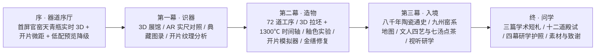

# 天青泥火 (Tianqing Nihuo) — 华夏古瓷三维研学空间 (v9.0)

> **从泥到火，从器到鉴——数字化复原宋瓷的一生**  
> *Tianqing Nihuo: From Clay to Fire, From Vessel to Connoisseurship — A 3D Study Space for Ancient Chinese Ceramics*

[](https://sherlockyzz.github.io/Memories-of-Chinese-Porcelain-Web/)
[](https://hub.xerj.org/contributors/SherlockYzz)
[](https://threejs.org/)
[](https://github.com/SherlockYzz/Memories-of-Chinese-Porcelain-Web)
[](docs/ARCHITECTURE.md)
[](https://creativecommons.org/licenses/by-nc-sa/4.0/)

---

## 在线体验与权威收录

- **GitHub Pages 在线访问**：https://sherlockyzz.github.io/Memories-of-Chinese-Porcelain-Web/  
  （由 GitHub Actions 自动执行 `npm run check && npm run build` 并将 `dist/` 部署至 Pages，支持桌面端 1280/1440/1920 与移动端 390px 自适应、中英双语切换、PWA 离线壳缓存与适老无障碍模式）
- **入选全球 AI 原生代码语料库 ([XERJ Corpus Hub](https://hub.xerj.org/contributors/SherlockYzz))**：  
  本项目纯前端 WebGL 物理釉面着色与三维研学工程架构获开源搜索项目 [XERJ](https://github.com/xerj-org/xerj) 官方索引收录。

---

## 科学诚实与模型口径声明

为保证数字文博科普与竞赛评审的严谨可信，全站所有数字资产与交互计算均严格区分来源与模型边界，并在页面首屏与 [《素材与致谢》](src/pages/sections/credits.html) 专题板块公开逐条溯源（配置于 [content/credits.json](content/credits.json)）：

1. **10 件核心名窑器物 (`public/models/masterpieces/*.glb`)**：依据传世馆藏公开器型与尺寸文献进行的 **Blender 参数化建模复原**（单器 6,144–31,440 三角面，255.6–703.2 KB，内嵌 `1024×1024` WebP 烘焙贴图），**并非文物实测三维激光扫描**。
2. **5 件现代对照标本 (`ceramic_vase_01~04`、`antique_ceramic_vase_01`)**：第三方 **Poly Haven CC0 1.0** 公开标准三维陶瓷模型（`1024×1024` JPEG 贴图），用于在图录与对比台中对照古今器型工艺差异。
3. **4 件宋代雅室环境道具 (`public/models/environment/*.glb`)**：由 Blender 5.2.3 LTS 重建并烘焙 WebP PBR 贴图（红木展示案 `84.8 KB`、宋式屏风 `52.7 KB`、紫檀展台 `79.3 KB`、三足青铜香炉 `300.1 KB`）。
4. **数值模拟与分析工具**：釉色离子呈色、1300℃ 烧成时间轴、开片过程模拟器及前端 Sobel 纹理与 RGB/HSL 分布分析均标注为**教学示意模型或权威学术文献范围值**（依据《中国陶瓷史》《中国科学技术史·陶瓷卷》《Ceramic Masterpieces》《Chinese Glazes》等），不用于古陶瓷真伪或年代鉴定。

---

## 四幕递进式研学体验架构

项目以 **“从泥到火，从器到鉴——数字化复原宋瓷的一生”** 为叙事主线，按五阶段展开：



### 核心与新增模块一览
- **序厅 & 全局交互**：3 分钟自动导览（`guided-tour.js`）、全局三维水墨山川与浑天星轨背景（随浅/深主题对比度调节与滚动视差联动，`webgl-bg/`）、统一指令面板 `Ctrl+K`、6 组核心快捷键与无障碍适老面板（`a11y-panel.js`：适老放大字号、高对比度、减少动效、Web Speech 语音朗读）。
- **第一幕 · 识器**：
  - **3D 展馆（`three-scene.js` + `glaze-shader.js`）**：宋代雅室/文博殿堂/御窑幽室三光景、多尺度 Voronoi 冰裂与橘皮微法线、积釉厚薄与官窑“紫口铁足”渐变、建盏薄膜虹彩、X 光纵向剖切、82° 翻转鉴底、双器同台并列比对与 100x 景深显微镜。
  - **AR / 桌面 1:1 实尺对照台（`ar-viewer.js`）**：检测 WebXR `immersive-ar` 能力，桌面端自动降级为器物与 15 cm 手机 / 7 cm 茶盏 / 30 cm 标尺同台比较，支持导出分享海报。
  - **名器典藏图录与纹理分析（`archive-catalog.js`、`ai-recognition.js`）**：26 条馆藏档案支持“CC0 对照标本 (5 件)”筛选及来源核验标识；前端像素级 RGB/HSL 与 Sobel 边缘梯度教学演示。
- **第二幕 · 造物**：
  - **3D 拉坯工坊 & 1300℃ 烧成时间轴（`pottery-workshop.js` + `firing-timeline.js`）**：44 层湿泥柱动态拉坯、青花勾线分水与 25°C–1300°C 八阶段烧成物相时间轴。
  - **釉色化学实验室（`glaze-chemistry.js`）**、**开片过程模拟器（`crackle-lab.js`）**（调节 Δα/釉厚/冷却速率实时生成双尺度 Voronoi 裂纹并合成冰裂声，导出 PNG 标本卡）、**金缮修复互动工坊（`kintsugi-game.js`）**（碎片拖拽/辅助吸附拼合 + 泥金/银缮/朱漆描金，导出完工证书）。
- **第三幕 · 入境 & 终 · 问学**：
  - **通史长卷、九州窑系地图、宋代七汤点茶百戏、视听研学（含按需加载视频与 Web Audio 声景）**。
  - **三篇学术短札（`notes.json` 含内联 SVG 原理图）**、**十二道博古殿试（`scholar-exam.js` 支持成绩单导出）**、**四幕研学护照（`passport.js` 随游览与实验自动解锁 8 枚印章并导出署名 PNG 证书）** 与 **《素材与致谢》（`credits.js`）**。

---

## 工程分层与目录结构

项目采用 **Vanilla ESM + esbuild 确定性构建 + JSON 内容驱动** 架构（无重型运行时框架开销）：

```text
Memories-of-Chinese-Porcelain-Web/
├── .github/workflows/deploy-pages.yml  # GitHub Actions 自动校验、构建与 Pages 发布
├── content/                            # 唯一业务内容与多语言数据源（不写死在代码内）
│   ├── vessels.json / archive.json     # 15 件三维器物（含壁厚/出处）与 26 条典藏档案
│   ├── glazes.json / reference-colors.json / scene.json
│   ├── crackle-lab.json / kintsugi.json / firing-timeline.json / passport.json / credits.json
│   ├── quiz.json / notes.json / kilns.json / history.json / workshop-steps.json ...
│   └── i18n/ (ui.json, en.exact.json, en.phrases.json)
├── src/
│   ├── core/                           # 零业务逻辑内核：bus/store/registry/actions/i18n/glaze-shader/data-service
│   ├── modules/                        # 14 个独立 ESM 业务模块 + webgl-bg/
│   ├── legacy/                         # 渐进兼容旧模块（经 legacy-bridge.js 与 data-shims.js 接入内核）
│   ├── pages/                          # 单一 HTML 入口（<!-- @include --> + {{content:...}} 注入）
│   └── styles/                         # 00-tokens.css（集中色彩/--z-*/透纱）-> 10~50-*.css
├── public/                             # 静态资产（models/, images/, audio/, videos/, webfonts/, sw.js, manifest.webmanifest）
├── dist/                               # esbuild 构建输出目录（GitHub Pages 发布产物）
├── tools/                              # build.mjs, check*.mjs, audit-models.mjs, verify-glaze-colors.mjs, blender/
├── tests/                              # Playwright 回归测试（run.mjs）与多视口截图对比（shots.mjs）
├── server/                             # 可选轻量后端示例（mock-api.mjs）；后端不可用时前端自动走静态兜底
├── docs/                               # ARCHITECTURE.md, MIGRATION.md, COMPETITION_PACK.md, ITERATION_PROMPT.md
└── reports/                            # model-audit.md, glaze-color-verify.md（shots/ 本地截图不入库）
```

---

## 本地开发、构建与自动化校验

需要 Node.js >= 20（构建与静态检查零浏览器依赖；端到端测试依赖本机 Chrome/Chromium 与 `playwright-core`）：

```bash
# 安装开发依赖（esbuild / playwright-core）
npm install

# 启动监听构建与本地预览服务器
npm run dev

# 生成带内容哈希的纯静态发布包至 dist/
npm run build

# 全量静态工程校验（内容字段完整性 / 中英 i18n 键对齐 / 样式层级 / 禁用内联事件与残留 emoji）
npm run check

# 二进制审计全部 GLB 面数、文件体积与贴图规格 -> reports/model-audit.md
npm run audit:models

# 运行 Playwright 全量 E2E 回归（1280/1440/1920 桌面与 390 手机零溢出、零报错、背景透出、创新模块与 503 静态兜底）
npm run test

# 采集 1440x900 与 390x844（浅/深主题 0/1400/3200/6000/10000px）回归截图
node tests/shots.mjs --out reports/shots/verify

# 釉面 CIELab ΔE2000 量化校色对比 -> reports/glaze-color-verify.md
node tools/verify-glaze-colors.mjs
```

---

## 工程与文档索引

- 工程分层与扩充手册：[docs/ARCHITECTURE.md](docs/ARCHITECTURE.md)
- 渐进重构迁移进度与回归指标对比：[docs/MIGRATION.md](docs/MIGRATION.md)
- 竞赛材料配套草稿（作品说明 / 3 分钟演示脚本 / 用户测试问卷）：[docs/COMPETITION_PACK.md](docs/COMPETITION_PACK.md)
- 后续迭代提示词基准：[docs/ITERATION_PROMPT.md](docs/ITERATION_PROMPT.md)
- 3D 资产二进制审计报告：[reports/model-audit.md](reports/model-audit.md)
- 釉色 Lab 色差验证报告：[reports/glaze-color-verify.md](reports/glaze-color-verify.md)

---

## 版本更新历史 (Changelog)

### v9.0 工程规范重构与创新体验升级 (2026.11)
1. **工程分层收敛与确定性构建**：废除根目录重复入口 `主代码.html` 与 2MB 手工 `bundle-core.js`，建立 `src/` + `content/` + `public/` -> `dist/` 的单源码 esbuild 管线与 `npm run check` 四维自动化静态校验；内置可选后端熔断器与全静态兜底接口。
2. **P0 渲染与响应式缺陷全量修复**：重构 `00-tokens.css` 与板块 `.section-surface` 透纱系统，解决 3D 背景下滚遮挡并提升浅色模式对比度与视差联动；补全全 15 件器物 `wallThickness` 与公式排版消除全部 `undefined` / 裸 LaTeX；解决 1440px 顶栏溢出、390px 手机横向溢出、工具条裁切与 3D 热点越界问题。
3. **3D 审计、道具重建与釉面物理升级**：使用 Blender 5.2.3 LTS 重建 4 件展厅环境道具并烘焙 WebP PBR 贴图；在 `glaze-shader.js` 实现积釉深浅、紫口铁足渐变、多尺度 Voronoi 冰裂与建盏薄膜虹彩，完成 8 窑口三视图与 CIELab ΔE2000 校色。
4. **五大创新模块、科学诚实与普惠能力**：新增开片过程模拟器、金缮修复互动工坊、1300℃ 烧成时间轴、AR/桌面 1:1 实尺对照台、四幕研学护照与《素材与致谢》专题板块，补充 12 题殿试、3 篇 SVG 原理短札、无障碍适老面板与 PWA 离线壳。

### v8.0 模块化解耦探索 (2026.10)
- 引入早期模块注册雏形、`webgl-ambient-bg` 浑天山川背景与 Blender 5.2 联动资产。

### v7.0 – v5.0 性能优化与核心交互里程碑
- 完成 10 件核心名瓷 WebP 1024 烘焙贴图轻量化、防死锁加载看门狗、双器同台对比、100x 光学景深显微镜、44 层湿泥拉坯形变动力学及局部对比度微应力热力可视化。

---

*网页开发 · 折木柯南 · [CC BY-NC-SA 4.0](LICENSE)*
