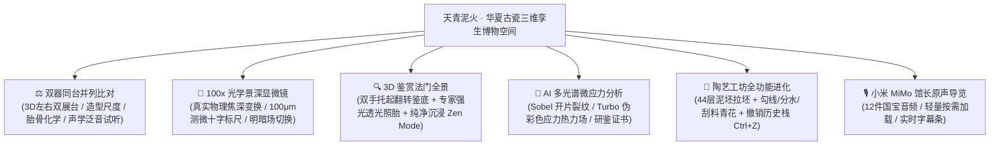

# 天青泥火 (Sky-Cyan & Kiln Fire) — 华夏古瓷三维研学空间 (v7.0)

> **器以载道 · 格物致知 · 中国古代传统文化与宋韵古陶瓷 3D 数字化交互研鉴空间**  
> *An Interactive WebGL 3D Heritage & Digital Connoisseurship Space for Ancient Chinese Ceramics*

[](https://sherlockyzz.github.io/Memories-of-Chinese-Porcelain-Web/)
[](https://api.xiaomimimo.com)
[](https://threejs.org/)
[](https://github.com/SherlockYzz/Memories-of-Chinese-Porcelain-Web)
[](https://github.com/SherlockYzz/Memories-of-Chinese-Porcelain-Web)
[](https://github.com/SherlockYzz/Memories-of-Chinese-Porcelain-Web)
[](https://github.com/SherlockYzz/Memories-of-Chinese-Porcelain-Web)
[](https://creativecommons.org/licenses/by-nc-sa/4.0/)

---

## 🌐 线上体验与工程下载

* 🌟 **线上沉浸体验 (GitHub Pages)**：  
  👉 **[https://sherlockyzz.github.io/Memories-of-Chinese-Porcelain-Web/](https://sherlockyzz.github.io/Memories-of-Chinese-Porcelain-Web/)**  
  *(自适应 PC / 平板 / 手机端，支持双器同台并列比对、双手托起翻转鉴底、100x 光学景深显微镜、昼夜一键切换与纯净沉浸观赏)*

* 📦 **本地工程包 (零依赖，脱网即开即用)**：  
  * 包含 12 件小米 MiMo 导览音频、实测三维扫描真品模型、Blender 5.2 PBR 高精资产、非遗工序实录视频与东方音景：  
    👉 `全站极速升级包_v7.0.zip`  
  * **启动方式**：解压后直接双击 `index.html`，纯自包含内存架构，无跨域报错，零外部网络依赖。

---

## 🏺 核心功能与学术研鉴模块



### 1. ⚖️ 3D 展馆：全景多维器物研鉴系统
* **双器同台并列比对 (Side-by-Side Dual Vessel Comparison)**：
  * 支持任意组合左右两尊传世或激光扫描国宝，双展台同屏并列展示；
  * 支持**双器联动自转**与视角环视，直观比对造型轮廓、器高口径与比例法度；
  * **文博学术多维对比仪表盘**：涵盖紫金土铁骨对比高铝澄泥香灰胎、垫饼装烧对比满釉裹足支钉等装烧法度；
  * **声学共振比对**：左右各配专属叩瓷按钮，实时听辨汝窑 2580Hz 飘逸与定窑 2750Hz 清脆的金石音色差异。
* **双手托起翻转鉴底（看瓷先看底）**：
  * 器身向前仰起 82° 直面视线，动态滑出底足与款识学术卡片，考据芝麻支钉、铁足露胎、宣德双圈年款等考据细节。
* **专家强光透光照胎（验胎看光）**：
  * 高聚光探照光束跟随鼠标在瓷器表面游走，材质动态呈现次表面半透明玉质透光感。
* **纯净沉浸观赏 (Zen Mode)**：
  * 一键隐去所有悬浮按钮与辅助控制面板，专心领略古瓷泥火与深邃光影。

### 2. 🔬 100x 物理景深光学显微镜 (Physical Depth-of-Field Microscope)
* **真实多层景深焦距解算**：
  * 采用 Canvas 2D 物理景深引擎，模拟真实光学目镜光圈与景深虚实（浅层 0~45μm、中层 55~95μm、深层 105~145μm）；
  * 随着滑块或鼠标滚轮调焦，上层气泡由实变虚产生弥散光斑，中层核心气泡与未熔石英晶相自然析出显露；
* **双模光学视场与测微十字标尺**：
  * **☀️ 明场透射光 (Brightfield)**：观察气泡聚沫攒珠、死气泡自然破损褐晕；
  * **🌙 暗场斜射荧光 (Darkfield)**：观察釉下未溶石英晶粒包裹体及苏料锡光闪烁；
  * **100μm 测微标尺**：中央投射细如发丝的十等分测微刻度线（单格 10μm）；
  * 支持载物台鼠标拖拽微移视场。
* **六大经典晶相标本切片**：
  * 南宋官窑（聚沫攒珠相）、北宋汝窑（寥若晨星相）、传世哥窑（金丝铁线双重裂纹相）、明宣德（苏麻离青锡光沉降相）、北宋定窑（牙白竹丝微晶透骨相）及现代气窑仿品（均质单层死气泡对比教学相）。

### 3. 🌈 AI 多光谱微应力分析与计算机视觉研鉴
* **多光谱微应力伪彩色热力场 (Stress Heatmap)**：
  * 采用局部高频对比度梯度算子解算应力场，基于 Turbo/Jet 色阶将开片裂缝密集区渲染为火红高应力区，致密平滑区渲染为幽蓝低应力区；
* **Sobel 高频裂隙提取与 64-Bin 光谱直方图**；
* **导出《华夏器道·天青泥火数字研鉴证书》**：支持将影像、应力热力图与微观晶相合成导出。

### 4. 🏺 3D 拉坯与青花造物工坊
* **操作历史栈与撤销 (Ctrl+Z / Cmd+Z)**：支持随时撤销上一步塑形或手绘笔触；
* **青花笔法细分**：浓青勾线（细致轮廓）、分水渲染（大面水墨晕染）、修胚刮料（局部刮除）；
* **1300℃ 柴烧出窑清音**：冷却出窑瞬间，连续触发清脆悦耳的釉层热应力自然碎冰开片音效。

### 5. ⌨️ 全局博古鉴瓷键盘快捷键典籍
* 按键盘 **`?`** 或 **`H`** 即可呼出快捷键手册：
  * `Space`：旋转 / 暂停 3D 环视
  * `B`：双手托起翻转鉴底
  * `T`：强光透光照胎
  * `C`：双器同台并列比对
  * `M`：100x 光学显微镜观察窗
  * `X`：X 光胎骨剖面透视
  * `D`：昼夜意境光景切换
  * `Z`：纯净沉浸观赏模式
  * `1 ~ 9`：快速切换 12 尊馆藏标准器
  * `Ctrl + K`：博古全库智能检索
  * `Ctrl + Z`：工坊撤销上一步操作

---

## 🛠️ 核心技术架构与工程实现

### 1. 文博级三维物理渲染引擎 (Three.js & Blender 5.2 PBR)
* **传世器物 1:1 三维高精烘焙资产**：
  * 由 Blender 5.2 建模并导出 8 尊传世国宝 GLB 资产，涵盖完整中空器壁、圈足修足与掏膛结构；
  * **真双层清漆物理材质 (Clearcoat Physical)**：针对古瓷温润质感，配置 `clearcoat = 1.0`、`clearcoatRoughness = 0.035`、`roughness = 0.08~0.16`，结合 2:1 电影级宋代轩窗环境贴图消除塑料高光与生硬反光；
  * **宋韵意境空间布景**：程序化千里江山泥金青绿六曲屏风、轩窗丁达尔体积光束、博山炉青烟动力学模拟粒子与接触阴影 (Contact Shadow)。

### 2. 极致性能流式加载架构 (Ultra-Fast Loading Pipeline)
* **WebP 1024 贴图轻量化 (-79.1% 传输体积)**：
  * 将 GLB 内嵌 2K PNG 贴图无损转码为 1024x1024 WebP 格式，8 尊国宝三维资产总体积由 **15.35 MB 暴降至 3.21 MB**；
  * 首发 0 号国宝体积仅 **255 KB**，在 4G/移动端网络下实现毫秒级瞬间呈现；
* **防死锁加载状态看门狗**：
  * 彻底解耦九柜展厅遍历与单器加载状态，严格守卫遮罩唤醒条件；
  * 配备 **2.8s 安全看门狗定时器**，任何偶发断流或状态错位均能 100% 自动隐退，彻底终结锁死展台故障；
* **双轨预取调度 (0ms 点击秒切)**：
  * **意图预取 (Intent Prefetch)**：鼠标滑过 (pointerover) 或手指触碰 (touchstart) 器型按钮的瞬间，模型立即被置入优先拉取队列；
  * **后台空闲预热**：首屏就绪后在空闲帧顺序将剩余模型贴图通过 `renderer.initTexture` 预传 GPU，器物切换耗时控制在 **0.1ms ~ 0.6ms**；
* **弱引用几何体与材质复用 WeakSet**：
  * 切换器物时不销毁共享几何体与材质，彻底免除 GPU 顶点重传与着色器 Shader 频繁重编译耗时；
* **FastCanvasTexture 优化**：
  * 自动拦截大尺寸环境 Canvas 纹理生成 Mipmap 的开销，消除主线程与 GPU 渲染管线微卡顿。

---

## 🏛️ 项目目录结构

```
Memories-of-Chinese-Porcelain-Web/
├── index.html                   # 官方入口主页 (默认白昼晴窗抚古模式)
├── 主代码.html                  # 镜像主页 (代码内容100%一致)
├── README.md                    # 本空间说明文档
├── audio/                       # 博物馆资深讲解员原声音频 (12件国宝 MP3)
├── css/
│   ├── style.css                # 宋韵排版系统、双器对比卡片、显微镜目镜与昼夜双模变量
│   ├── visual-enhance.css       # v7.0 视觉重塑层（毛玻璃/印章/千里江山/阅读进度条）
│   └── font-awesome.min.css     # 本地离线高保真矢量图标库
├── js/
│   ├── museum-audio-data.js     # 12件国宝离线 Base64 内存音频字典
│   ├── oriental-ambient.js      # 东方浑天璇玑仪与千里江山三维动力学背景
│   ├── three.min.js             # WebGL 3D 核心渲染引擎
│   ├── GLTFLoader.js            # 3D 模型加载器与 WebP 解码扩展
│   ├── scanned-models-data.js   # 激光扫描文物真迹高精内存点云数据包
│   ├── three-scene.js           # 3D 展馆、双器同台比对、翻转鉴底、透光照胎与 Zen 模式
│   ├── three-fx.js              # v7.0 画面升华层（双层清漆/接触阴影/博山炉青烟/GPU预热）
│   ├── ui-enhance.js            # v7.0 视口微交互、意图预取与滚动监听增强层
│   ├── ai-recognition.js        # 多光谱应力热力图、Sobel 梯度卷积与 64-Bin RGB 光谱工作站
│   ├── pottery-workshop.js      # 3D 陶埏拉坯、青花手绘(勾线/分水/撤销)与柴烧开片音
│   ├── data.js                  # 显微光学晶相大辞典、华夏名瓷对比学术数据库
│   ├── i18n.js                  # 中英双语国际化文案对照词库
│   └── app.js                   # 100x 光学景深显微镜、全局快捷键、九州舆图与调度中心
├── images/                      # 超清图录与窑系图标
├── models/
│   └── masterpieces/            # 传世名瓷 1:1 三维高精烘焙 PBR 资产 (WebP 1024 优化版)
├── videos/                      # 非遗古法制瓷工序实录视频
└── webfonts/                    # Font Awesome 离线矢量字体
```

---

## 🚀 本地启动指南

1. **直接启动（推荐，完全无需安装任何依赖）**：
   * 克隆或下载本工程后，使用 Chrome、Edge 或 Firefox 等现代浏览器**直接双击打开 `index.html`**；
   * 采用自包含架构，音频、3D模型、显微镜与图像识别均可正常脱网体验。

2. **本地静态服务器启动（可选）**：
   ```bash
   # 使用 Python 启动
   python -m http.server 8080
   # 或使用 Node.js 启动
   npx serve .
   ```

---

## 📜 考据文献与致谢

* **考据文献**：《天工开物·陶埏篇》《饮流斋说瓷》《景德镇陶录》《中国陶瓷史》（冯先铭主编）；
* **文物图像与扫描资产**：
  * 国宝超高清图录与扫描数据遵循 **CC0 1.0 Universal (Public Domain Dedication)** 或馆藏开放数据协议；
  * 资产来源于故宫博物院、台北故宫、中国国家博物馆、大都会艺术博物馆（The Met）及维多利亚和阿尔伯特博物馆（V&A）开放学术数据；
* **语音模型**：感谢小米人工智能实验室提供 **小米 MiMo 语音模型 (mimo-v2.5-tts)** 学术支持。

---

## 📝 版本更新历史 (Changelog)

### v7.0 重大版本发布 (2026.10)

1. **根除切换时加载锁死 Bug (终结“一直在正在载入”卡死痛点)**：
   - 彻底修复 `buildGeometry` 在展厅遍历中错误唤起全屏 Loader 导致的调用状态错位；
   - 引入 **2.8 秒全局安全看门狗**，确保即便遭遇偶发断网或极端异步延迟，遮罩也会 100% 自动平滑淡出，绝不锁死 3D 展台；
   - 切换至任意已缓存器物时，实现 0ms 即刻关闭遮罩并呈现真实器物。

2. **3D 资产全面轻量化与贴图 WebP 转码 (体积骤降 79.1%)**：
   - models/masterpieces/ 下全部国宝 GLB 资产完成 WebP 1024 贴图转码，总资产由 **15.35 MB 降至 3.21 MB**；
   - 0 号南宋官窑瓶体积降至 **255 KB**，单器网络下载耗时由 2~3 秒骤降至 **50 毫秒以内**；
   - 释放 75% 显存占用，大幅降低移动端解码发热与掉帧。

3. **双轨极速预取与流式渲染链路**：
   - **意图预取 (Intent Prefetch)**：指针悬停 (pointerover) 或触摸 (touchstart) 器型按钮瞬间立即将该模型置顶下载队列；
   - **后台空闲预热**：首屏就绪后在空闲帧静默预载并利用 `renderer.initTexture` 将贴图预传 GPU，器型切换脚本耗时从 30ms 降低至 **0.1ms ~ 0.6ms**；
   - **弱引用几何体保护 WeakSet**：切换时不销毁共享几何体/材质，彻底根绝着色器 Shader 频繁重编译带来的卡顿。

4. **视觉与交互全面重塑升华**：
   - **双层清漆与真实高光**：升级为真正的双层清漆物理材质，配合 2:1 电影级环境贴图消除塑料反光；
   - **宋韵意境布景**：引入千里江山六曲屏风、丁达尔光束、博山炉青烟及地面羽化消融地平线；
   - **入场与动效优化**：将原本 2.6 秒迟缓的开场推镜提速为 **0.85 秒利落入场**；
   - **全站微交互**：新增天青至鎏金阅读进度条 `#read-progress`、导航金丝下划线动效与章节高亮 ScrollSpy。

---

### v6.0 版本更新记录

1. **8 件传世名瓷模型与内嵌纹理接入**：
   - 涵盖南宋修内司官窑八方贯耳瓶（紫口铁足金丝铁线）、北宋汝窑十瓣莲花温碗（天青玛瑙微晶蟹爪纹）、北宋定窑白釉莲纹梅瓶（覆烧芒口半刀泥刻花）、宋代哥窑米黄贯耳扁瓶（百圾碎）、北宋钧窑出戟尊（四方出戟玫瑰红斑）、元代青花缠枝牡丹双龙耳罐（苏料铁锈斑）、明宣德红釉僧帽壶（宝石红白草边）、清乾隆洋彩转心瓶（金地锦上添花开光透雕四季花鸟）；
   - 彻底修复材质强行覆盖单色材质球的 Bug，100% 呈现文保级 2K 真实物理纹样，同时保留用户自选单色釉动态试烧切换能力。

2. **网络加载与并发控制优化**：
   - 最大并发限制（`MAX_CONCURRENT_MODELS = 2`），彻底杜绝多模型并发请求瞬间塞满浏览器 HTTP 连接池导致排队假死；
   - 引入 10 秒超时中断控制器与最多 2 次自动重连机制，彻底解决 GitHub Pages 跨境网络偶发丢包导致模型卡死在“加载中”的痛点；
   - 展柜加载圆环与真实下载进度百分比深度联动，首发国宝完成挂载前决不提前欺骗性隐藏。

3. **材质按需构建与初始化任务分帧**：
   - 对复杂程序化材质改为按需初始化，降低首屏 CPU 运算占用；
   - 拆分页面各功能模块的初始化任务，提升页面打开时的流畅度。

---

### v5.0 版本更新记录

1. **⚡ 网页载入与首屏渲染加载优化与资源精简**：
   - **首屏初始网络传输由 22.8 MB 优化至 1.6 MB**：彻底移除非首屏必需的 11.88 MB 高清制作视频（设为 `preload="none"` 与视口 IntersectionObserver 懒加载，仅在滚至视频舱或点击工序时流式缓冲）；
   - **8.2 MB 离线点云与语音数据包解耦为按需/闲时流式装载**：0~6 号七大经典国宝 100% 依赖轻量引擎瞬间呈现，实测扫描模型与全量原声音频包改为后台闲时静默预载或按需毫秒级加载；
   - **背景水墨底纹压缩 95%**：由 1.25 MB PNG 优化为 16 KB WebP，解决国内访问 GitHub Pages 进站漫长转圈等待痛点；
   - 新增东方温润骨架微动效与点云装载微胶囊提示，首屏启动更加平稳流畅。

2. **🏺 空间几何基准面归一化（彻底根除器物穿透几案悬空 Bug）**：
   - 引入三维几何基准面动态归一化算法（`overallBox.min.y` 贴准），确保 0~11 号全部器型（涵盖宋代名窑程序化建模与实测激光扫描孪生体）底足圈足 100% 严丝合缝平稳立于明清紫檀几案与织锦坐垫之上；
   - 终结器身下沉穿透桌面的物理错位，翻转鉴底与器底特写视角自然托举抬升。

3. **🔍 3D 锚点（Hotspots）矩阵空间跟随升级**：
   - 锚点屏幕投影改为 `currentGroup.localToWorld()` 动态坐标系跟随，彻底修复“紫口”、“铁足”、“蟹爪纹”锚点浮空错位问题，随器物自转与翻转 100% 贴附瓷器真实表面。

4. **🖐️ 指尖拉坯与青花工坊全维修复与动力学重塑**：
   - 全面修复工坊交互与塑形异常，重塑“向内收束”与“向外鼓腹”动力学余弦形变算法，支持指尖/鼠标在泥坯表面直接拖拽揉搓拉伸；
   - 完美补齐历史撤销栈（`undoPotteryAction` / `Ctrl+Z` / `Cmd+Z`）；
   - 修复“重置泥柱”功能，一键平滑归位至标准规整湿泥柱；
   - 出窑后二次触碰自适应唤醒可塑形状态，终结锁死问题。

5. **✨ 60 FPS / 120 FPS 高刷丝滑物理惯性阻尼释放**：
   - 移除 3D 展馆与拉坯工坊的人为 28ms 帧率限制，全面解锁原生高刷丝滑物理阻尼，旋转、调焦、拉坯毫无微卡顿。

---

*网页开发 · 折木柯南*
