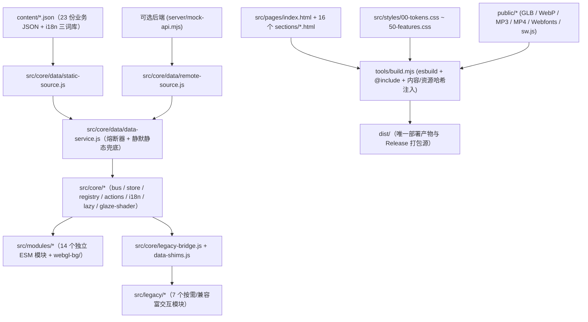

# 天青泥火 (Tianqing Nihuo) — 华夏古瓷三维研学空间 (v9.1.0)

> **从泥到火，从器到鉴——数字化复原中国古瓷的一生**  
> *Tianqing Nihuo: From Clay to Fire, From Vessel to Connoisseurship — A 3D Study Space for Ancient Chinese Ceramics*

[](https://sherlockyzz.github.io/Memories-of-Chinese-Porcelain-Web/)
[](https://github.com/SherlockYzz/Memories-of-Chinese-Porcelain-Web/releases/latest)
[](https://hub.xerj.org/contributors/SherlockYzz)
[](https://threejs.org/)
[](https://github.com/SherlockYzz/Memories-of-Chinese-Porcelain-Web)
[](docs/ARCHITECTURE.md)
[](LICENSE)

---

## 一、在线访问与最新版本整合包

- **GitHub Pages 在线研学**：https://sherlockyzz.github.io/Memories-of-Chinese-Porcelain-Web/  
  由 GitHub Actions（[.github/workflows/deploy-pages.yml](.github/workflows/deploy-pages.yml)）在每次推送 `main` 时自动执行全量静态校验与确定性生产构建，部署纯静态站点。
- **GitHub Releases 离线整合包（v9.1.0）**：https://github.com/SherlockYzz/Memories-of-Chinese-Porcelain-Web/releases/latest  
  每次打标签由 [.github/workflows/release.yml](.github/workflows/release.yml) **清空历史缓存后全量冷构建**，输出最新 `TianQingNiHuo.zip`（完整 `dist/` 纯静态网站包）与 `SHA256SUMS.txt` 校验文件，解压后通过任意静态 HTTP 服务器即可离线运行。
- **官方索引收录**：本项目纯前端 WebGL 物理釉面着色与三维研学架构已被全球 AI 原生代码语料库 [XERJ Corpus Hub](https://hub.xerj.org/contributors/SherlockYzz) 官方收录。

---

## 二、网页全量功能详解（五大篇章 + 全局能力）

网站以 **“从泥到火，从器到鉴”** 为主线，组织为 **全局体验系统 + 五大递进篇章**：

### 0. 全局体验与性能引擎
- **首屏秒开与并发预载 + 模型韧性**：通过精简首屏关键代码（约 `1469 KB`）、并发预热后续视区资产、`Service Worker`（`public/sw.js`）不可变内容哈希缓存隔离与 GLB 模型超时重试机制，确保全站高清图录图片、音频与三维模型完整稳定呈现。
- **全局 3D 自动律动水墨山川背景（`src/modules/webgl-bg/`）**：WebGL 背景山川与浑天星轨具备**自主呼吸微震动律动**，并实时与鼠标悬停拖拽、滚轮视差自然叠加；浅/深双主题下通过语义透纱变量（`.section-surface`）保持前景文字对比度与背景景深透视。
- **全站无障碍与高效导览**：
  - **3 分钟自动研学导览**（`src/modules/guided-tour.js`）：一键沉浸式串联全站重要展区；
  - **统一指令面板 `Ctrl+K`**：快速检索全站 26 件馆藏、窑口与交互实验直达跳转；
  - **中英双语瞬时切换**（`src/core/i18n.js`）：核心 UI 键零延迟切换，英文大词典（`i18n-en`）按需懒加载；
  - **适老与无障碍面板**（`src/modules/a11y-panel.js`）：字号分级放大、高对比度模式、减弱动画与 Web Speech 语音朗读；
  - **浅/深色主题切换**（`src/modules/theme.js`）与 **PWA 离线安装支持**（`src/modules/pwa.js`）。

### 序 · 器道序厅（`src/pages/sections/hero.html`、`src/modules/hero-vessel.js`）
- **首屏官窑天青瓶实时 3D 展示**：打开首页即可 360° 交互把玩主展器物，结合开片微距观察与设备性能自适应策略。

### 第一幕 · 识器（观其形、辨其釉、察其纹）
1. **数字孪生 3D 立体展馆（`src/pages/sections/3d-gallery.html`、`src/legacy/three-scene.js`、`src/core/glaze-shader.js`）**：
   - 收录 **15 件三维古瓷资产**（10 件基于传世名窑经典器型与尺寸文献通过 Blender 5.2 参数化重建并烘焙 `1024×1024` WebP 贴图 + 5 件 Poly Haven CC0 陶瓷对照标本）与 **4 件宋代雅室 PBR 环境道具**（红木展示案、千里江山三折屏风、紫檀展台、三足铜香炉）。
   - 支持 **宋代雅室 / 文博殿堂 / 御窑幽室** 三套光照场景、`onBeforeCompile` 双层微晶清漆釉面着色、积釉深浅渐变、官窑「紫口铁足」表现、建盏薄膜虹彩效果、**X 光纵向剖切**（结合壁厚指标）、**82° 翻转鉴底**（真篆体御制/官窑落款）、**双器同台并列比对**与 **100x 光学景深显微镜**。
2. **WebXR / 桌面 1:1 实尺对照台（`src/modules/ar-viewer.js`）**：
   - 自动检测设备 `immersive-ar` 能力；桌面端提供 **15 cm 智能手机 / 7 cm 茶盏 / 30 cm 标尺** 同台 1:1 物理尺寸参照，支持导出高分辨率对比海报。
3. **名器典藏图录（`src/pages/sections/archive.html`、`src/modules/archive-catalog.js`）**：
   - 汇聚 **26 条馆藏档案**，支持朝代/窑系多维检索、CC0 对照标本筛选、一键跳转对应 3D 鉴赏视角及十二件名瓷导览原声播放。
4. **前端像素级釉面纹理实验室（`src/pages/sections/ai-recognition.html`、`src/legacy/ai-recognition.js`）**：
   - 上传或选用器物图片，在纯浏览器端实时演算 **RGB/HSL 色彩直方图** 与 **Sobel 边缘梯度热力图**，辅助直观理解胎釉光影与开片纹理分布。

### 第二幕 · 造物（泥坯、青花、窑火与修补）
1. **360° 柱面 UV 指尖拉坯与手绘青花数字工坊（`src/pages/sections/pottery-studio.html`、`src/legacy/pottery-workshop.js`）**：
   - **44 层湿泥动态塑形**：提供「向内收束 / 向外鼓腹 / 跟随修光」工具及宋定窑梅瓶、玉壶春瓶、大吉葫芦瓶、建窑斗茶盏经典器型预设，实时计算器高、口径、腹径、容积与宋韵美学评分。
   - **真实 360° 柱面 UV 青花渲染引擎**：内置 `512×256` 双层离屏 UV 画布（预设层 `presetUVCanvas` + 自由手绘层 `paintUVCanvas`）与 `32` 扇条半球透视重投影（`hemiCanvas`），任意笔画严密贴合肩腹收束曲率无缝旋转。
   - **四种青花笔法与毫锋控制**：支持 **勾线（中锋描边）/ 分水（柔边水墨晕染）/ 点斑（苏麻离青铁锈结晶斑）/ 刮料（局部修拭）**，配备 **细 / 中 / 粗** 三档笔锋、**转盘定格 / 恢复旋转**、一键清空，以及 `Ctrl+Z` 同步撤销泥坯轮廓与手绘图层。
   - **秘制矿物釉与 1300℃ 柴窑蜕变动画**：可选 **雨过天青、龙泉粉青、官窑月白、景德镇永宣甜白釉（无开片洁净釉面）、钧窑玫瑰紫、建盏乌金兔毫** 6 款釉色；入窑烧造前青花呈哑光灰青泥料色，经 25℃→1300℃ 实时升温曲线烧造后以 `multiply` 融合进瓷胎、玻璃高光覆于表面，还原「釉下青花」质感；支持镌刻四字朱文方印并导出高分辨率造物典藏证书海报。
2. **1300℃ 烧成全过程物相与呈色时间轴（`src/modules/firing-timeline.js`）**：
   - 八阶段（25℃、120℃、500℃、573℃ α-β石英相变、950℃ 素烧、1150℃ 液相、1250℃ CO 强还原焰 $\text{Fe}^{3+}\to\text{Fe}^{2+}$、1300℃ 玻化定型）交互式时间轴与胎釉实时色板演进。
3. **过手七十二工序与釉色化学实验（`workshop.html`、`colors.html`）**：
   - 拆解传统制瓷工艺脉络与五大名窑典型釉色矿物发色规律。
4. **双尺度 Voronoi 冰裂开片过程模拟器（`src/pages/sections/crackle-lab.html`、`src/modules/crackle-lab.js`）**：
   - 调节 **胎釉热膨胀系数差（Δα）/ 釉层厚度 / 冷却速率**，实时生成金丝铁线双尺度裂纹网格，依托 Web Audio 合成清脆出窑开片声景并导出高清标本卡。
5. **古瓷金缮修复互动工坊（`src/pages/sections/kintsugi.html`、`src/modules/kintsugi-game.js`）**：
   - 支持碎片拖拽与磁吸拼合、选择 **泥金 / 银缮 / 朱漆描金** 工艺填补裂隙，体验“残缺之美”的修补哲学并导出修复完工证书。
6. **空灵瓷韵 · 古瓷五声编磬（`pottery-studio.html` & `pottery-workshop.js`）**：
   - 点击宫、商、角、徵、羽琴键或按键盘 `1–5` 键，基于 Web Audio API 物理泛音合成聆听不同窑口胎骨共振清音。

### 第三幕 · 入境（历史长河、窑口版图、点茶与声景）
- **八千年华夏陶瓷通史长卷**（`history.html`）与 **九州名窑地理分布交互图谱**（`kiln-map-section.html`）；
- **宋代文人四艺（焚香、点茶、挂画、插花）与七汤点茶百戏**（`four-arts.html`）；
- **视听研学影院与东方声景**（`video-theatre.html`、`src/legacy/oriental-ambient.js`）：按需流式加载影像与古琴泛音、雨打芭蕉环境声景。

### 终 · 问学（文献短札、博古殿试、研学护照与致谢）
- **三篇学术短札**（`notes.html`、`content/notes.json` 含内联 SVG 物理原理解析图）；
- **十二道博古殿试**（`content/quiz.json` 支持即时判分与研学成绩单导出）；
- **四幕研学护照**（`passport.html`、`src/modules/passport.js`）：随浏览 3D 展馆、完成 1300℃ 窑烧、开片实验、金缮修复与殿试自动点亮 8 枚朱文印章并导出署名结业证书；
- **《素材与致谢》专题板块**（`credits.html`、`src/modules/credits.js`、`content/credits.json`）。

---

## 三、完整代码架构解析

项目采用 **Vanilla ESM + esbuild 确定性构建 + JSON 内容驱动** 单源码架构，彻底告别冗余打包脚本与全局状态混乱：



### 1. 分层目录与核心模块职责
- **`content/`（唯一内容与多语言真源）**：
  - 23 份结构化业务 JSON（`vessels.json`、`archive.json`、`glazes.json`、`reference-colors.json`、`scene.json`、`crackle-lab.json`、`kintsugi.json`、`firing-timeline.json`、`passport.json`、`credits.json`、`quiz.json`、`notes.json`、`kilns.json`、`history.json`、`workshop-steps.json`、`literati-arts.json`、`microscope.json`、`comparison.json`、`pentatonic.json`、`reign-marks.json`、`colors.json`、`navigation.json`、`site.json`）；
  - `content/i18n/`：`ui.json`（核心界面键值）+ `en.exact.json` & `en.phrases.json`（英文词典）。
- **`src/core/`（零业务逻辑工程内核）**：
  - `bus.js` / `store.js` / `storage.js`：跨模块发布订阅总线（`AppBus`）与持久化状态管理；
  - `registry.js`：三阶段模块生命周期管理与自动清理（`ctx.listen` / `ctx.subscribe` / `ctx.onDispose`）；
  - `actions.js`：全站唯一声明式 `[data-action]` 事件委托分发器（零内联 `onclick`）；
  - `lazy.js`：按逻辑分块名触发懒加载（`IntersectionObserver` 接近视口或 `requestIdleCallback` 闲时加载）；
  - `glaze-shader.js`：Three.js 物理釉面扩展引擎，注入双尺度 Voronoi 冰裂、橘皮微法线、积釉厚薄与薄胎/紫口铁足计算；
  - `data/data-service.js`：统一异步数据层，支持自动检测可选后端与零感知静态 JSON 兜底；
  - `i18n.js`、`modal.js`、`toast.js`、`dom.js`、`legacy-bridge.js`、`global-shim.js`。
- **`src/modules/`（14 个标准 ESM 独立模块 + `webgl-bg/`）**：
  - `theme.js`、`navigation.js`、`guided-tour.js`、`hero-vessel.js`、`archive-catalog.js`、`crackle-lab.js`、`kintsugi-game.js`、`firing-timeline.js`、`ar-viewer.js`、`passport.js`、`a11y-panel.js`、`credits.js`、`pwa.js`、`index.js`（统一模块注册入口）及 `webgl-bg/` 三维背景引擎。
- **`src/legacy/`（富交互核心引擎与兼容层）**：
  - `three-scene.js`、`three-fx.js`、`pottery-workshop.js`（360° 柱面 UV 青花渲染 + 44 层拉坯）、`ai-recognition.js`、`oriental-ambient.js`、`data-shims.js`、`ui-enhance.js`。
- **`src/styles/`（单一视觉令牌样式体系）**：
  - `00-tokens.css`（集中管理全站色彩、`--z-*` 层级、阴影与 `.section-surface` 透纱透明度）→ `10-layout.css` → `20-nav.css` → `30-hero.css` → `40-sections.css` → `50-features.css` 及 `legacy/`。
- **`tools/` 与构建分块产物（`tools/build.mjs`）**：
  - 确定性构建输出：**首屏必载** `vendor-icons.css` + `app.css` + `vendor.js` + `legacy.js` + `app.js` + `index.html`（共约 `1469 KB`），以及 **4 个按需懒加载分块**：`legacy-pottery`（`35 KB`）、`legacy-ambient-2d`（`6.1 KB`）、`legacy-ai`、`i18n-en`，所有文件名均自动注入短内容哈希以实现 `sw.js` 长效不可变缓存。

### 2. 四维质量门禁与自动化运维流水线
- **`npm run check`**（`tools/check.mjs`）：串行执行 `check-content`（JSON 必填字段与资源路径实存）、`check-i18n`（中英词条严格对齐与 HTML 键覆盖）、`check-style`（现代样式零违规与 `!important` 计数守护）与 `check-code`（禁用内联事件、禁用 ESM 模块挂载全局 `window` 变量）。
- **`npm run test`**（`tests/run.mjs`）：使用 Playwright 在无头浏览器中实测 **1280 / 1440 / 1920 桌面端与 390px 移动端**的浅/深双主题，校验零控制台错误、零 404、零横向与顶栏溢出、背景透出、创新模块弹窗与无后端兜底。
- **双路 GitHub Actions**：`.github/workflows/deploy-pages.yml`（推送 `main` 即部署 Pages）与 `.github/workflows/release.yml`（推送 `v*` 标签即全量冷构建、校验、打包 `TianQingNiHuo.zip` 并自动清理历史旧版 Release 与旧 Tag）。

---

## 四、本地开发与构建命令

需 **Node.js >= 20**（构建与静态检查零浏览器依赖；Playwright 回归需本地 Chrome/Chromium 与 `playwright-core`）：

```bash
# 安装开发依赖
npm install

# 启动监听增量构建与本地预览服务
npm run dev

# 清空重建带内容哈希的纯静态产物至 dist/
npm run build

# 全量四维静态工程校验
npm run check

# 运行 Playwright 全量 E2E 回归断言
npm run test

# 审计全站 GLB 模型面数与贴图体积 -> reports/model-audit.md
npm run audit:models
```

---

## 五、正面致谢与学术典据

谨向为本项目提供开源模型、学术研究文献、语音合成与图形学基础工具的学者与社区致以诚挚敬意（完整条目见 [content/credits.json](content/credits.json)）：

- **三维模型与数字复原**：原创十件名窑传世器型参数化复原及宋代雅室展陈道具（Blender 5.2 PBR）；致谢 **Poly Haven**（James Ray Cock）提供 5 件 CC0 公共领域陶瓷三维参考模型。
- **权威学术文献与古籍参考**：
  - 中国硅酸盐学会主编《中国陶瓷史》（文物出版社，1982）
  - 李家治主编《中国科学技术史·陶瓷卷》（科学出版社，1998）
  - W. D. Kingery & P. B. Vandiver, *Ceramic Masterpieces* (Free Press, 1986)
  - Nigel Wood, *Chinese Glazes* (A&C Black, 1999)
  - 古籍文献：《天工开物·陶埏》《大观茶论》《饮流斋说瓷》《景德镇陶录》
- **声景、语音与开源基础设施**：致谢小米人工智能实验室 **MiMo 语音模型（`mimo-v2.5-tts`）** 提供十二件名瓷典藏语音导览，以及 Web Audio API、Three.js、Tailwind CSS 等开源图形生态。

---

## 六、版本更新历史 (Changelog)

- **v9.1.0 (2026.11)**：升级 **360° 柱面 UV 青花渲染引擎与永宣甜白釉**（双层柱面反投影、勾线/分水/点斑铁锈斑/刮料、细中粗笔锋、转盘定格、1300℃ 生坯灰青→釉下宝蓝蜕变、`Ctrl+Z` 双撤销与视口自动唤醒）；优化 **首屏秒开预载与 SW 缓存隔离**；上线 **3D 自动律动山川背景**、正面学术致谢与 **GitHub Release 全量冷构建+自动清除旧版发版工作流**。
- **v9.0.0 (2026.11)**：完成 `src/` + `content/` + `public/` → `dist/` 单源码确定性架构重构与五大创新研学模块落地。
- **v8.0.0 – v5.0.0**：完成 WebGL 3D 交互背景、Blender 5.2 PBR 资产构建与 1024 WebP 轻量化、双器对比与 100x 光学景深显微镜等基础能力建设。

---

**版权制作：折木柯南** · 开源许可协议：[CC BY-NC-SA 4.0](LICENSE)
