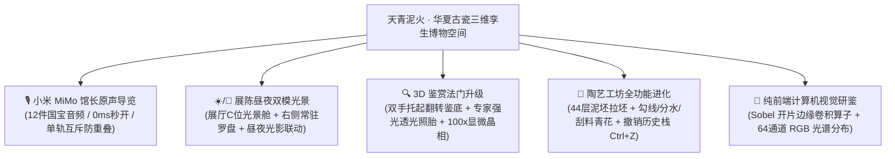

# 天青泥火 (Sky-Cyan & Kiln Fire) — 华夏古瓷三维孪生博物空间

> **器以载道 · 格物致知 · 中国古代传统文化与宋韵古陶瓷 3D 数字化交互研鉴空间**  
> *An Interactive WebGL 3D Heritage & Digital Connoisseurship Space for Ancient Chinese Ceramics*

[](https://sherlockyzz.github.io/Memories-of-Chinese-Porcelain-Web/)
[](https://api.xiaomimimo.com)
[](https://threejs.org/)
[](https://github.com/SherlockYzz/Memories-of-Chinese-Porcelain-Web)
[](https://github.com/SherlockYzz/Memories-of-Chinese-Porcelain-Web)
[](https://creativecommons.org/licenses/by-nc-sa/4.0/)

---

## 🌐 线上体验与工程下载

* 🌟 **线上沉浸体验 (GitHub Pages)**：  
  👉 **[https://sherlockyzz.github.io/Memories-of-Chinese-Porcelain-Web/](https://sherlockyzz.github.io/Memories-of-Chinese-Porcelain-Web/)**  
  *(自适应 PC / 平板 / 手机端，支持触屏轨道旋转、昼夜一键切换、双手托起翻转鉴底与全屏沉浸)*

* 📦 **本地工程包 (零依赖，脱网即开即用)**：  
  * 包含 12 件小米 MiMo 导览音频、实测三维扫描真品模型、非遗工序实录视频与东方音景：  
    👉 `天青泥火.zip`  
  * **启动方式**：解压后直接双击 `index.html`，纯自包含内存架构，无跨域报错，零外部网络依赖。

---

## 🏺 核心特色与学术模块



### 1. 🔍 专业 3D 古陶瓷鉴赏法门
* **双手托起翻转鉴底（看瓷先看底）**：
  * 点击【翻转鉴底】，相机与瓷器平滑联动，器身优雅仰起 82° 直面观众，避开底座遮挡；
  * 动态滑出【底足与款识学术研考卡片】，详尽考据芝麻支钉痕（汝窑）、紫口铁足露胎（官窑）、大明宣德双圈楷书款等断代核心要领。
* **专家强光透光照胎（验胎看光）**：
  * 点击【强光照胎】，开启高聚光手电探照光束，跟随鼠标在瓷器表面游走；
  * 材质动态呈现微晶次表面透光与薄胎半透明玉质感，展现白瓷、青瓷温润含蓄的内部宝光。
* **100x 显微镜微观晶相研考**：
  * 观测宋代汝窑“寥若晨星”、官窑“聚沫攒珠”、宣德青花“大泡如珠小泡如雾”等釉下微观气泡衰变分布。

### 2. 🏺 3D 拉坯与青花造物工坊
* **操作历史栈与撤销（Undo / Ctrl+Z）**：
  * 完整记录每一步拉坯塑形与青花绘痕，支持一键撤销（Ctrl+Z / Cmd+Z），解决画错无法回退的痛点；
* **传统青花笔法细分**：
  * **浓青勾线**（细致描绘缠枝与轮廓花纹）；
  * **分水渲染**（大面积水墨晕染淡青分水）；
  * **修胚刮料**（局部橡皮擦刮除修改）；
* **1300℃ 柴烧出窑清音**：
  * 烧成出窑冷却时，连续触发清脆悦耳的釉层热应力自然碎冰开片音效。

### 3. 🎙️ 博物馆原声导览引擎
* **文脉解说**：借助小米多模态语音模型 `mimo-v2.5-tts`，定制博物馆资深讲解员语调，为 12 件传世与扫描国宝生成生动温润的解说音频；
* **双模离线架构**：支持物理文件播放与 Base64 内存流秒播，彻底免疫本地文件跨域限制；
* **单轨互斥设计**：同一时刻仅允许单一路音频发声，切歌自动重置旧音频，根治连击重音杂音；
* **文博字幕同步**：播放时实时滚动展示器物考据字幕条。

### 4. ☀️/🌙 展陈昼夜双模光景系统
* **便捷显性入口**：3D 展馆 C 位光景切换舱、全站右侧浮动「国风昼夜罗盘」与顶部导航徽章；
* **两种东方审美意境**：
  * **☀️ 晴窗抚古 (白昼素雅·默认)**：澄心堂宣纸底色、晨曦温润天光，还原宋代青瓷的如玉质感；
  * **🌙 夜宴观瓷 (暗夜玄金)**：深色金砖地面、烛火微茫与聚光灯投射，展现深邃静穆的高光反射。

### 5. 🔬 纯前端计算机视觉研鉴
* **Sobel 一阶梯度卷积算子**：实时提取釉面开片应力网络与器型边缘；
* **64通道 RGB 光谱直方图**：实时解算釉色三原色分布、色相环与裂纹密度；
* **研鉴证书导出**：支持生成并下载《华夏器道·天青泥火数字研鉴证书》。

---

## 🏛️ 项目目录结构

```
Memories-of-Chinese-Porcelain-Web/
├── index.html                   # 官方入口主页 (默认白昼晴窗抚古模式)
├── 主代码.html                  # 备份主页 (代码内容100%一致)
├── README.md                    # 本空间说明文档
├── audio/                       # 博物馆资深讲解员原声音频 (12件国宝 MP3)
├── css/
│   ├── style.css                # 宋韵排版系统、昼夜双模变量与玻璃拟态
│   └── font-awesome.min.css     # 本地离线高保真矢量图标库
├── js/
│   ├── museum-audio-data.js     # 12件国宝离线 Base64 内存音频字典
│   ├── oriental-ambient.js      # 东方浑天璇玑仪与千里江山三维动力学背景
│   ├── three.min.js             # WebGL 3D 核心渲染引擎
│   ├── GLTFLoader.js            # 3D 模型加载器与 Polyfill
│   ├── scanned-models-data.js   # 激光扫描文物真迹高精内存点云数据包
│   ├── three-scene.js           # 3D 展馆、双手托起翻转鉴底与透光照胎引擎
│   ├── ai-recognition.js        # Sobel 梯度卷积与 64-Bin RGB 光谱直方图工作站
│   ├── pottery-workshop.js      # 3D 陶埏拉坯、青花手绘(勾线/分水/撤销)与柴烧开片音
│   ├── data.js                  # 华夏名瓷学术知识图谱与款识考据库
│   ├── i18n.js                  # 中英双语国际化文案对照词库
│   └── app.js                   # 九州舆图、点茶百戏、古瓷化学实验室与调度中心
├── images/                      # 超清图录与窑系图标
├── models/                      # 实测扫描 3D PBR 真迹模型资产
├── videos/                      # 非遗古法制瓷工序实录视频
└── webfonts/                    # Font Awesome 离线矢量字体
```

---

## 🚀 本地启动指南

1. **直接启动（推荐，完全无需安装任何依赖）**：
   * 克隆或下载本工程后，使用 Chrome、Edge 或 Firefox 等现代浏览器**直接双击打开 `index.html`**；
   * 采用自包含架构，音频、3D模型与图像识别均可正常脱网体验。

2. **本地静态服务器启动（可选）**：
   ```bash
   # 使用 Python 启动
   python -m http.server 8080
   # 或使用 Node.js 启动
   npx serve .
   ```

---

## 📜 考据文献与致谢

* **考据文献**：《天工开物·陶埏篇》《饮流斋说瓷》《景德镇陶录》《中国陶瓷史》（冯先铭主编）；
* **文物图像与扫描资产**：
  * 国宝超高清图录与扫描数据遵循 **CC0 1.0 Universal (Public Domain Dedication)** 或馆藏开放数据协议；
  * 资产来源于故宫博物院、台北故宫、中国国家博物馆、大都会艺术博物馆（The Met）及维多利亚和阿尔伯特博物馆（V&A）开放学术数据；
* **语音模型**：感谢小米人工智能实验室提供 **小米 MiMo 语音模型 (mimo-v2.5-tts)** 学术支持。

---

*网页开发 · 折木柯南*
