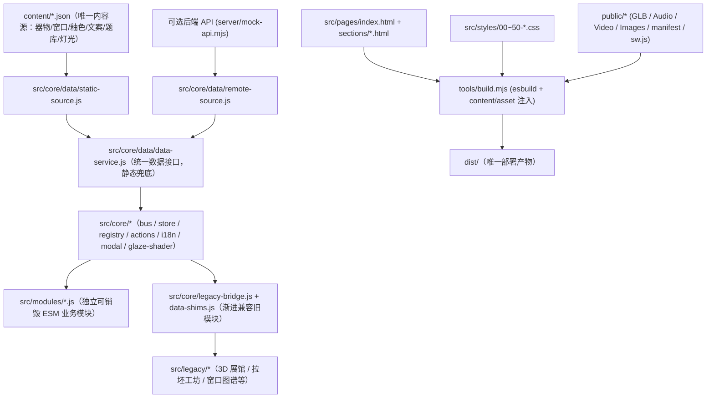

# 《天青泥火·华夏古瓷三维研学空间》工程架构文档

## 1. 设计目标与工程分层

项目采用 **Vanilla ESM + esbuild 确定性构建 + JSON 内容驱动** 架构（无重型前端框架运行时开销，保留 Three.js r128 稳定三维生态），严格分离“内容数据 / 内核总线 / 业务模块 / 样式令牌 / 静态资产”：

## 2. 目录清单

- `content/`：全站所有结构化业务数据与多语言资源，修改文本或器物仅改此处：
  - `site.json`, `navigation.json`, `vessels.json`, `glazes.json`, `reference-colors.json`, `scene.json`
  - `archive.json`, `reign-marks.json`, `history.json`, `kilns.json`, `workshop-steps.json`, `colors.json`
  - `literati-arts.json`, `microscope.json`, `comparison.json`, `pentatonic.json`, `notes.json`, `quiz.json`
  - `crackle-lab.json`, `kintsugi.json`, `firing-timeline.json`, `passport.json`, `credits.json`
  - `i18n/ui.json`, `i18n/en.exact.json`, `i18n/en.phrases.json`
- `src/core/`：内核层（零业务逻辑）：
  - `bus.js`（事件总线）、`store.js`（持久化状态）、`registry.js`（三阶段模块注册与资源回收 `ctx.listen/subscribe/onDispose`）
  - `actions.js`（声明式 `[data-action]` 委托，彻底消灭内联 `onclick`）
  - `data/data-service.js` + `static-source.js` + `remote-source.js` + `user-data.js`
  - `i18n.js`（`data-i18n` + `data-content` + 按需懒加载英文大词典）
  - `glaze-shader.js`（多尺度 Voronoi 开片纹理、橘皮微法线与 `onBeforeCompile` 物理釉层着色器增强）
- `src/modules/`：已模块化 ESM 业务组件清单：
  - `theme.js`、`navigation.js`、`guided-tour.js`、`hero-vessel.js`、`webgl-bg/`
  - `archive-catalog.js`、`crackle-lab.js`、`kintsugi-game.js`、`firing-timeline.js`、`ar-viewer.js`
  - `passport.js`、`a11y-panel.js`、`credits.js`、`pwa.js`
- `src/legacy/`：仍处于渐进兼容期的既有富交互模块（经 `legacy-bridge.js` 与 `data-shims.js` 访问同一份 `core` 与 `content/`）。
- `src/styles/`：分层令牌样式：
  - `00-tokens.css`（唯一颜色、阴影、字栈、`--z-*` 层级、透纱透明度来源）
  - `10-layout.css`、`20-nav.css`、`30-hero.css`、`40-sections.css`、`50-features.css`、`legacy/`
- `tools/`：工程构建、审计与校验脚手架（`build.mjs`, `build.config.mjs`, `check*.mjs`, `audit-models.mjs`, `verify-glaze-colors.mjs`, `blender/rebuild_env_props.py`）。
- `tests/`：Playwright 真实浏览器截图（`shots.mjs`）与端到端回归断言（`run.mjs`）。

## 3. 标准扩展操作手册

### 3.1 如何新增一件三维器物
1. 将 `.glb` 模型放入 `public/models/masterpieces/`，渲染预览图放入 `public/images/collection/`；
2. 在 `content/vessels.json` 末尾新增对象，补全必填字段：`id`, `order`, `name`, `period`, `kiln`, `dimensions`, `wallThickness`, `desc`, `defaultGlaze`, `model`, `bottom`, `provenance`, `reference`；
3. 若需加入对比台或典藏图录，在 `content/comparison.json` / `content/archive.json` 同步登记；
4. 运行 `npm run check:content && npm run audit:models && npm run build` 校验。

### 3.2 如何新增一个独立 ESM 模块
1. 若有内容文案，在 `content/` 新建 `<name>.json` 并在 `src/core/data/static-source.js` 注册；
2. 若有独立板块 HTML，在 `src/pages/sections/<name>.html` 编写，并使用 `<section class="section-surface" id="<name>">`，通过 `<!-- @include sections/<name>.html -->` 引入 `src/pages/index.html`，并在 `content/navigation.json` 添加入口；
3. 在 `src/modules/<name>.js` 调用 `defineModule({ id, phase, init(ctx), destroy(), actions, onLangChange })`，事件监听一律通过 `ctx.listen` / `ctx.subscribe` 注册；
4. 在 `src/modules/index.js` 中 `import './<name>.js'`。

### 3.3 如何新增或修改界面文案与多语言
1. 修改页面结构文案：修改 `content/site.json`、`content/navigation.json` 或各模块 JSON；
2. 修改 UI 界面键值：编辑 `content/i18n/ui.json` 的 `zh` 与 `en`；
3. 运行 `npm run check:i18n` 确保中英键完全对齐、无漏翻。

## 4. 构建、校验与部署流程
- 开发监听与本地预览：`npm run dev`
- 生产构建：`npm run build`（生成带内容哈希产物至 `dist/`）
- 静态全量校验：`npm run check`（JSON/资源完整性、i18n、样式规范、代码规范）
- 3D 模型审计与釉色验证：`npm run audit:models`、`node tools/verify-glaze-colors.mjs`
- 全量视觉与功能回归：`npm run test`
- 部署：`dist/` 目录为纯静态发布包，可直接推送至 GitHub Pages（`gh-pages` 分支）或上传任意国内静态 CDN。
